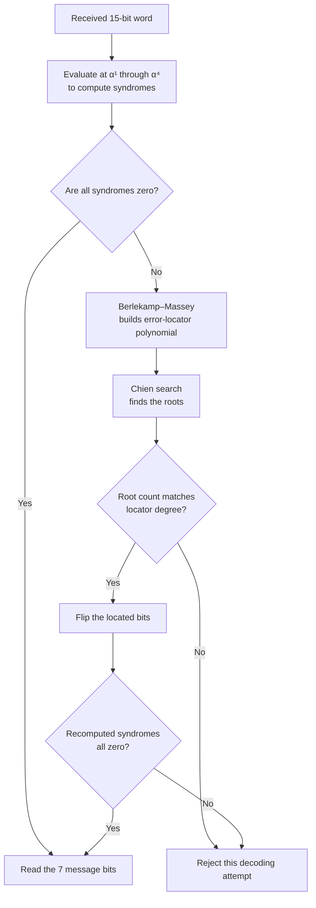

## TL;DR

- Hocquenghem published the construction in 1959; Bose and Ray-Chaudhuri independently published the binary-code construction in 1960.
- BCH adds check bits so each protected block can recover from any pattern of up to a chosen number of flipped bits.
- The decoder computes checks that depend on the damage, uses them to locate the flipped positions, and repairs those bits.
- Reed–Solomon protects the main payload on CDs and QR codes; BCH has had a major footprint in flash memory and communications standards.
- The demo exhaustively verifies every message and every pattern of up to two errors for BCH(15,7).

It is easy to think that the data on a hard drive, the music on a CD, the information inside a QR code, that all of this just... sits there faithfully, perfectly, never decaying. And that when a system does handle errors, there is probably a retry mechanism somewhere, some blunt "try again" in the code.

Retries do exist, but they are not enough. Storage and communication systems add **redundancy**, extra bits calculated from the original data, so a receiver can detect or correct damage without already possessing the original. The complete protected block is a **codeword**. The storage device or communication path that may corrupt it is the **channel**. Sometimes redundancy is smaller than the payload and sometimes, as in the toy code below, it is larger. The exact tradeoff depends on the code and the channel.

---


## 1959, and a small embarrassment of riches

In 1959, Alexis Hocquenghem published a paper in *Chiffres*, the journal of the Association française de calcul (the French numerical-computation society). The paper described a new class of error-correcting codes, one where you could specify how many errors you wanted to correct, then construct the code to meet that requirement. Before, you designed a code and then measured what it could handle. Hocquenghem reversed the order. [Wikipedia, "BCH code"](https://en.wikipedia.org/wiki/BCH_code)

One year later, in March 1960, two mathematicians at the University of North Carolina at Chapel Hill, Raj Chandra Bose and Dijen Kumar Ray-Chaudhuri, published essentially the same construction in *Information and Control*. Their paper was titled "On a Class of Error Correcting Binary Group Codes." [*Information and Control*, vol. 3, March 1960](https://www.sciencedirect.com/science/article/pii/S0019995860900232) A companion paper, "Further Results on Error Correcting Binary Group Codes," followed in September of the same year.

They didn't know about each other. Hocquenghem didn't read Bose and Ray-Chaudhuri before publishing; Bose and Ray-Chaudhuri didn't read Hocquenghem. This happens in mathematics more often than the textbooks let on, two people staring at the same shape of problem, arriving at the same solution, in different countries, in nearly the same moment.

The codes are now named **BCH codes**: Bose-Chaudhuri-Hocquenghem.

---

## Who Bose was

Raj Chandra Bose was born on June 19, 1901, in Hoshangabad, in what was then the Central Provinces of British India, present-day Madhya Pradesh. [MacTutor, "Raj Chandra Bose"](https://mathshistory.st-andrews.ac.uk/Biographies/Bose_Raj/)

His earlier career was at the Indian Statistical Institute in Kolkata, where he worked under P. C. Mahalanobis on experimental design, combinatorics, and association schemes. In 1949, he left for the United States and joined UNC Chapel Hill, before later working at Colorado State University.

By 1960, Bose was fifty-eight and had already published foundational work on block designs and association schemes. He understood the algebra well enough to recognize an engineering problem as a combinatorics problem in disguise.

Dijen Kumar Ray-Chaudhuri was working at UNC when the paper appeared; he had finished his PhD there under Bose in 1959. He later spent most of his career at Ohio State University. [Wikipedia, "Dijen Ray-Chaudhuri"](https://en.wikipedia.org/wiki/Dijen_K._Ray-Chaudhuri)

---

## What they were building on

Shannon's 1948 channel-coding theorem established the possibility of arbitrarily reliable communication, provided the transmission rate stays below the channel's capacity and suitable codes are used. It did not hand engineers an efficient decoder for every situation. [Shannon, 1948](https://people.math.harvard.edu/~ctm/home/text/others/shannon/entropy/entropy.pdf)

Richard Hamming at Bell Labs built the first practical family in 1950 [Wikipedia, "Hamming code"](https://en.wikipedia.org/wiki/Hamming_code): codes that correct exactly one bit error per block. Hamming(7,4) takes 4 data bits and encodes them as 7, adding 3 parity bits arranged so that any single-bit corruption reveals its own location. The syndrome tells you which bit is wrong. Flip it back. Done.

But only one error. Corrupt two bits in a Hamming codeword and the decoder either misidentifies the error or silently produces the wrong answer. In the real world, where errors come in bursts, where a scratch on a disc hits consecutive bits, where a power fluctuation flips several bits at once, one error per block wasn't enough.

The problem waiting to be solved was: can you build a code where the guaranteed random-bit error capacity is a design parameter? Burst errors require another move, usually interleaving, because several adjacent corruptions can overwhelm one codeword.

---

## The algebra, since you asked

A **polynomial** is a sum of powers such as $x^3+x+1$; its coefficients here are bits. The next trick is to treat a bit string as one. `1011`, for example, can represent $x^3+x+1$: each bit says whether that power of $x$ is present. Addition then becomes XOR because coefficients are only zero or one.

Start with a **finite field**, a finite collection of values where addition, subtraction, multiplication, and division by non-zero values always stay inside the collection. Clock arithmetic suggests wrapping around, but arithmetic modulo 16 is not this field: for example, 2 has no inverse modulo 16. Here the sixteen elements are four-bit polynomials, and multiplication wraps by a polynomial rule instead. A Galois field $GF(2^m)$ contains exactly $2^m$ elements; for our BCH(15,7,t=2) example, $GF(2^4)$ has sixteen.

The field has a **primitive element** $\alpha$. Its fifteen powers $\alpha^0,\alpha^1,\ldots,\alpha^{14}$ visit every non-zero field element before cycling, with $\alpha^0=1$ and $\alpha^{15}=1$. The polynomial $x^4+x+1$ supplies the reduction rule $\alpha^4=\alpha+1$, preventing powers from growing forever. It is **irreducible**, meaning it cannot be factored into smaller nonconstant binary polynomials, which is what makes the resulting arithmetic a field. [Wikipedia, "BCH code"](https://en.wikipedia.org/wiki/BCH_code)

Addition in $GF(2^4)$ is **XOR**, bitwise addition without carries: equal bits give 0, unequal bits give 1. Thus $(\alpha+1)+\alpha=1$ because the two $\alpha$ terms cancel. Multiplication uses ordinary polynomial expansion followed by reduction; for example, $\alpha^3\cdot\alpha=\alpha^4=\alpha+1$. Log tables speed this up by recording which power of $\alpha$ names each non-zero element, so multiplying becomes adding exponents modulo 15. `code/bch_demo.py` builds those tables. [MathWorks, Galois-field arithmetic](https://www.mathworks.com/help/comm/ug/working-with-galois-fields.html)

A **linear code** stays valid when two codewords are XORed. A **cyclic code** of length $n$ also stays valid when a codeword is rotated. Its **generator polynomial** $g(x)$ acts like a template: valid codewords are exactly the binary polynomials divisible by it. If $g(x)$ has degree $n-k$, each codeword contains $k$ message bits and $n-k$ parity bits.

A **root** is a value that makes a polynomial evaluate to zero. The BCH move is to choose $g(x)$ so that $\alpha,\alpha^2,\ldots,\alpha^{2t}$ are roots, where $t$ is the number of bit flips we want to guarantee correcting. Because $g(x)$ must have ordinary binary coefficients, we collect the **minimal polynomial** for each root, the smallest binary polynomial that vanishes there, and take their least common multiple: the lowest-degree polynomial divisible by every one of them. That produces the smallest generator containing every required root.

The result is the **BCH bound**: if $g(x)$ has $2t$ consecutive powers of $\alpha$ as roots, then the minimum Hamming distance is at least $2t+1$. Hamming distance is simply the number of bit positions where two codewords differ. If every pair of valid codewords is at least five flips apart, a received word with two errors is still closer to the original codeword than to any other. That is why distance five corrects two errors. [Lin & Costello, *Error Control Coding*, 2nd ed.](https://www.sciencedirect.com/book/9780130830678/error-control-coding)

For BCH(15, 7, t=2), 15 is the protected block length, 7 is the number of message bits, and 2 is the guaranteed correction capacity:

- g(x) = x⁸ + x⁷ + x⁶ + x⁴ + 1
- This has α¹, α², α³, α⁴ as roots, four consecutive powers
- Minimum distance ≥ 5, so t = 2 errors correctable
- 8 parity bits, 7 message bits, 15-bit codeword

Note the cost: 8 parity bits to protect 7 message bits. More overhead than payload. That's the price of this small code's guarantee.

The code in `code/bch_demo.py` verifies this exhaustively: all 128 possible 7-bit messages survive every possible pattern of zero, one, or two flipped bits. The Chien search output `[2, 11]`, two positions pulled from a corrupted word without consulting the original, is where the algebra becomes concrete.

---

## Syndromes

The reason syndrome decoding feels like magic: **the syndrome doesn't depend on which message you sent**.

Let $c(x)$ be the transmitted codeword, $e(x)$ mark the flipped positions, and $r(x)=c(x)+e(x)$ be what arrives. Evaluating the received polynomial at a root $\alpha^i$ of $g(x)$ gives:

$$
r(\alpha^i)=c(\alpha^i)+e(\alpha^i)
=0+e(\alpha^i)=e(\alpha^i)
$$

The first term vanishes because c(x) is a multiple of g(x). What you're left with is the error at α^i, purely a function of the damage, not the original message.

The decoder computes syndrome values S₁ through S₄. These are four damage checks, each evaluating the same received word at a different field element. All zero means the received word is a valid codeword, not a universal proof that nothing changed: enough flips can turn one valid word into another.

For non-zero checks, **Berlekamp–Massey** finds the shortest recurrence fitting the syndrome sequence. Its coefficients form the **error-locator polynomial** $\Lambda(z)$. Each flipped bit at position $j$ contributes a field locator $\alpha^j$; the corresponding root is its multiplicative inverse $\alpha^{-j}$, not the reciprocal of the integer $j$. [MathWorks, decoding algorithm](https://www.mathworks.com/help/comm/ug/block-codes.html)

For the demo's flips at positions 2 and 11, the locator has the form

$$
\Lambda(z)=(1+\alpha^2z)(1+\alpha^{11}z).
$$

At $z=\alpha^{-2}$ the first factor is $1+1=0$; at $z=\alpha^{-11}$ the second vanishes. We do not know those positions in advance. The syndrome recurrence supplies the polynomial, and trying the fifteen candidates reveals its roots.

Then **Chien search** tries $\alpha^{-i}$ for each bit position $i$ from 0 to $n-1$. Here $i$ is a zero-based coefficient-list index, not a character index in a conventional high-to-low printed bit string. A zero identifies a candidate error position. Flip the located bits and recompute the checks before reading the message. This guarantees recovery within the two-error limit; beyond it, even a wrong answer may pass the checks. [MathWorks, excessive errors](https://www.mathworks.com/help/comm/ref/bchdec.html)


In the animation, positions run low-degree first, as in the demo: parity in 0–7, message in 8–14. Flipping bits 2 and 11 makes all four checks non-zero. Working only from those checks, the locator scan stops at 2 and 11, and flipping them back silences the checks and returns the original seven message bits.

. Press play to watch the animation.")



For this small decoder, Berlekamp–Massey scales with the square of the correction capacity and the Chien search checks each codeword position. The decoder never looks at the original message, only at the syndrome left by the damage. That is a property of linear codes generally, but BCH makes it unusually visible.

---

## The actual footprint

**Reed-Solomon codes**, published in 1960 by Irving Reed and Gustave Solomon at MIT Lincoln Laboratory, in the *Journal of the Society for Industrial and Applied Mathematics*, are what's actually inside CDs, DVDs, and QR codes. [Wikipedia, "Reed–Solomon error correction"](https://en.wikipedia.org/wiki/Reed%E2%80%93Solomon_error_correction) RS codes share the finite-field algebraic foundations with BCH codes and were published in the same remarkable year, but they're technically distinct: RS codes operate at the byte (or symbol) level rather than the bit level.

CDs use **CIRC**, Cross-Interleaved Reed-Solomon Coding, a layered construction of two RS codes with interleaving that spreads a burst of physical damage across codewords. [Wikipedia, "Compact disc"](https://en.wikipedia.org/wiki/Compact_disc) DVDs use RS Product-like codes. QR codes use Reed-Solomon for the main payload, with four error-correction levels (L, M, Q, H) [Wikipedia, "QR code"](https://en.wikipedia.org/wiki/QR_code), and, in a small irony, they also use a BCH(15,5) code for the format information field that encodes which error-correction level and mask pattern are in use. BCH shows up in QR codes; just not where most people think it does.


BCH has also been used in NAND flash, where stored charge becomes harder to distinguish as cells wear. The precise code and correction capacity depend on the device; modern controllers may use other families such as LDPC. BCH is explicitly specified as an outer code in **DVB-S2**, digital satellite broadcasting: data passes through this code and then another coding stage before transmission. [ETSI EN 302 307-1, section 5.3](https://www.etsi.org/deliver/etsi_en/302300_302399/30230701/01.04.01_60/en_30230701v010401p.pdf)

---

## The part that sits with me

Across 1959 and 1960, four papers were published that helped build the algebraic theory of error correction: Bose & Ray-Chaudhuri (two papers), Hocquenghem, and Reed & Solomon. Two of those four were by Bose and Ray-Chaudhuri, both Indian-born. The papers arrived in a remarkably short window.

This doesn't mean there was some coordinated effort, or that it was India's contribution specifically, Hocquenghem was French, Reed and Solomon were American, and Bose and Ray-Chaudhuri were working in North Carolina. It means that 1960 was when the Shannon-theory bottleneck broke open, and that when it broke, two of the people holding the hammer had grown up in a country that, at the time, had almost no digital computing infrastructure of its own.

Raj Chandra Bose died in 1987, in Fort Collins, Colorado. He was eighty-six. The BCH codes paper was one item in a long career, arguably his most consequential result in engineering impact.

He probably never owned a flash drive.

---

## Run the code

The demo in `code/bch_demo.py` implements both Hamming(7,4) and BCH(15,7,t=2) from scratch in Python 3, no libraries, GF(2⁴) arithmetic, polynomial division for encoding, syndrome computation, Berlekamp-Massey, and Chien search.

```bash
python code/bch_demo.py
```

The output shows Hamming failing on two errors, then BCH finding and correcting two errors in a 15-bit word. The exhaustive sweep covers all 128 messages and all 13,440 two-error message/error-pattern combinations, with zero failures.


A production BCH implementation may live in dedicated hardware and include optimizations and code parameters this demo does not. But the finite-field arithmetic, syndrome calculation, error-locator polynomial, and root search in `code/bch_demo.py` are the same core ideas.

---
Test the algebraic decoder in `code/bch_demo.py` by injecting three errors instead of two. Beyond two errors, a rejection or a wrong valid codeword is expected behaviour, not by itself an implementation bug. Compare the returned message with the known original and record which outcome occurs. Report an issue if a pattern within the guaranteed two-error limit fails.

## Sources & further reading

- R. C. Bose and D. K. Ray-Chaudhuri, "On a Class of Error Correcting Binary Group Codes," *Information and Control*, vol. 3, no. 1, pp. 68–79, 1960. [ScienceDirect (paywalled)](https://www.sciencedirect.com/science/article/pii/S0019995860900232)
- A. Hocquenghem, "Codes correcteurs d'erreurs," *Chiffres*, vol. 2, pp. 147–156, 1959. (French; original BCH paper by Hocquenghem)
- I. S. Reed and G. Solomon, "Polynomial Codes over Certain Finite Fields," *Journal of the Society for Industrial and Applied Mathematics*, vol. 8, no. 2, pp. 300–304, 1960. [SIAM (paywalled)](https://epubs.siam.org/doi/10.1137/0108018)
- Wikipedia, "BCH code": https://en.wikipedia.org/wiki/BCH_code
- Wikipedia, "Reed–Solomon error correction": https://en.wikipedia.org/wiki/Reed%E2%80%93Solomon_error_correction
- Wikipedia, "Raj Chandra Bose": https://en.wikipedia.org/wiki/Raj_Chandra_Bose
- Wikipedia, "Dijen Ray-Chaudhuri": https://en.wikipedia.org/wiki/Dijen_Ray-Chaudhuri
- MacTutor History of Mathematics, "Raj Chandra Bose": https://mathshistory.st-andrews.ac.uk/Biographies/Bose_Raj/
- Wikipedia, "Compact disc" (CIRC section): https://en.wikipedia.org/wiki/Compact_disc
- Wikipedia, "QR code" (error correction section): https://en.wikipedia.org/wiki/QR_code
- Wikipedia, "Hamming code": https://en.wikipedia.org/wiki/Hamming_code
- ETSI EN 302 307-1 (DVB-S2 standard, BCH outer code): https://www.etsi.org/deliver/etsi_en/302300_302399/30230701/01.04.01_60/en_30230701v010401p.pdf
- Shu Lin and Daniel J. Costello Jr., *Error Control Coding*, 2nd ed., Prentice Hall, 2004. (The standard graduate textbook; Table 6.3 gives BCH(15,7) generator polynomial)
- R. E. Blahut, *Algebraic Codes for Data Transmission*, Cambridge University Press, 2003. (Ch. 7 for Berlekamp-Massey)

- [Shannon (1948), A Mathematical Theory of Communication](https://people.math.harvard.edu/~ctm/home/text/others/shannon/entropy/entropy.pdf).
- [MathWorks, Working with Galois Fields](https://www.mathworks.com/help/comm/ug/working-with-galois-fields.html).
- [MathWorks, Block Codes](https://www.mathworks.com/help/comm/ug/block-codes.html).
- [MathWorks, bchdec](https://www.mathworks.com/help/comm/ref/bchdec.html).
- [Ohio State, Dijen Ray-Chaudhuri](https://math.osu.edu/people/ray-chaudhuri.1).

## Get the code

[Download the demo ZIP](/blog/assets/code/data-that-repairs-itself/data-that-repairs-itself.zip) · [View source on GitHub](https://github.com/Sukalyan2003/Sukalyan2003.github.io/tree/main/blog/assets/code/data-that-repairs-itself)

Extract the ZIP and open the `data-that-repairs-itself` folder, then run:

```bash
python3 code/bch_demo.py
```

It needs only the Python 3 standard library. The `code/README.md` includes the test command and expected output.
