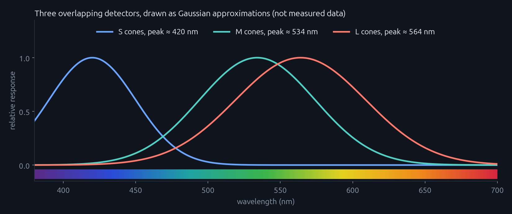
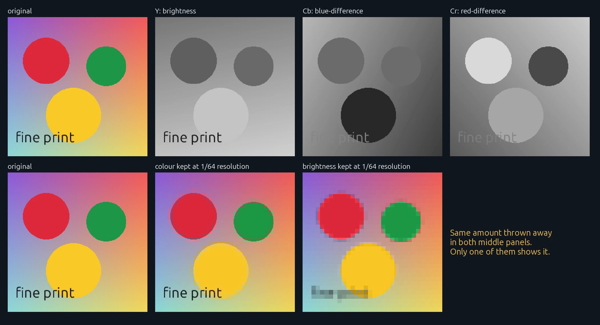
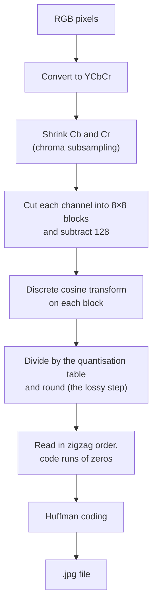
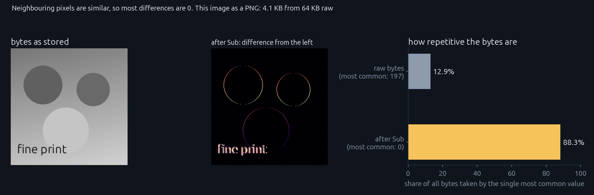

## TL;DR

- Your eye measures colour with three overlapping kinds of sensor, so three numbers per pixel are enough to fool it, that's the reason RGB works.
- Different colour spaces (RGB, CIE XYZ, CMYK, HSV, YCbCr) are different coordinate systems for those three numbers, each picked for a job.
- JPEG is lossy. It keeps brightness detail, throws away colour detail and fine texture the eye barely notices, then packs what's left tightly.
- PNG is lossless. It predicts each byte from its neighbours and compresses the leftovers.
- QOI does a similar job to PNG with a spec that fits on a page.

In my third year of university I took Image Processing. Most people I studied with hated it, but it was one of my favourite courses in the entire degree. 

The number of channels, the order of the steps in JPEG, even why your phone's photos are a few megabytes instead of thirty, all of it traces back to how a human eye works and what it fails to notice. This post is derived straight from my personal notes. 

## Three sensors, three numbers

At the back of your eye are two kinds of light-sensitive cell. Rods are very sensitive and handle dim light, but they don't distinguish colour, and in daylight they're mostly saturated. Colour comes from cones, and there are three types.

They're usually called L, M and S, for long, medium and short wavelength. It's tempting to call them red, green and blue, but their responses overlap heavily. The L cone's peak is around 564 nm, which is closer to yellow-green than red. The M cone peaks around 534 nm. Only the S cone sits clearly apart, near 420 nm.



There isn't a neat formula for these curves. They're measured experimentally, and the bell shapes above are a rough fit for illustration.

The important consequence is that any light hitting your eye, however complicated its spectrum, gets reduced to three numbers: how strongly each cone type responded. Two lights with completely different spectra that produce the same three responses look identical. They're called *metamers*, and they are the reason a screen works at all.

.")

So a colour, as far as you're concerned, is a point in three dimensions. Feed every single wavelength through the three curves and you trace a curved path through that space. Real light is usually a mix of many wavelengths, and mixing light adds responses, so everything between those points can be reached too. 

The set of reachable points is convex: you can't leave it by mixing things inside it.

.")

That leaves an odd corner of the space. Points like "M cones fully on, L cones off" exist mathematically, but because the two curves overlap, no light can produce them. These are sometimes called *impossible colours*.

## Coordinate systems for colour

Once colour is a 3D point, a *colour space* is a choice of axes for describing that point, the way a location can be given as latitude and longitude or as a street address. Converting between colour spaces is a change of coordinates. Each common one exists because some job is easier in its coordinates.

**CIE XYZ (1931).** Cone responses couldn't be measured directly in the 1920s, so researchers ran *colour-matching experiments* instead. An observer looked at a test colour and turned three knobs controlling three coloured lamps until their mix matched it. Averaging many observers gave the International Commission on Illumination (CIE) a *standard observer*: a table of how much of each lamp an average person needs to match every wavelength. XYZ is built from those tables.

It is a *linear transformation* of the cone responses, meaning each of X, Y and Z is a fixed weighted sum of L, M and S, so mixtures of light stay mixtures in the new coordinates. Its Y axis was chosen to match perceived brightness. That Y is *relative luminance*: light weighted by how sensitive the eye is at each wavelength, scaled so white is 1. It isn't the same thing as physical luminance, an absolute quantity in candela per square metre that a light meter reports. Nearly every other colour space is defined relative to XYZ, which makes it the common reference when converting between them.

**RGB.** A screen is made of tiny red, green and blue lights. Their exact colours are the display's *primaries*, and an RGB value is just three brightness settings, one per primary. Mixing three fixed primaries can only reach the points inside the triangle they form, so every display has a *gamut*, the set of colours it can actually produce. A real colour outside that triangle, a very saturated cyan for example, gets shown as the nearest colour the screen can manage. sRGB, the default on the web, fixes one set of primaries and has a fairly small gamut.

One wrinkle catches nearly everyone. The 0 to 255 numbers in an RGB file are not proportional to the amount of light. They're *gamma-encoded*: roughly, the stored value is the light intensity raised to the power 1/2.2, so a stored 128 means about 22% of full brightness, not 50%. Part of the reason is historical, since CRT monitors responded to voltage along a similar curve. Part is practical, since eyes tell dark shades apart better than bright ones, so spending more of the 256 codes on darks wastes fewer of them. A comment under the colour video I learned this from puts it bluntly:

. The reply's correction is the precise version: sRGB is linear near black and a 2.4 power curve above it.")

The practical rule: convert to linear light before mixing, blending or resizing colours, and convert back afterwards. Averaging the stored numbers directly makes blends come out too dark.

**CMYK.** Screens start from black and *add* light, so more of each primary means brighter. Printers start from white paper and *subtract*: each ink absorbs part of the light that would otherwise bounce off the page. Cyan ink absorbs red, magenta absorbs green and yellow absorbs blue, so each ink removes one screen primary. In theory all three together absorb everything and make black. In practice they make a muddy brown, use three times the ink and soak the paper, so printers add a real black ink. That's the K, for *key*, the printing plate the other colours were lined up against.

**HSV.** Hue, saturation and value describe colour the way people talk about it. *Hue* is the position around a colour wheel, as an angle from 0° to 360°: red at 0°, green at 120°, blue at 240°. *Saturation* is how vivid the colour is, from grey at 0 to fully pure. *Value* is how far the colour is from black. All three are calculated directly from RGB, which is why colour pickers use HSV: each slider changes one property people care about.

.")

The formulas show one thing clearly: value is just the largest of the three channels. That makes it a poor measure of how bright a colour looks. Pure blue and pure yellow both have a value of 100, and yellow looks far brighter.

**YCbCr.** One brightness channel and two colour channels. Y here is *luma*, a weighted sum of the gamma-encoded R, G and B values that approximates perceived brightness. Careful texts write it Y′ to keep it apart from luminance. Cb is the *blue-difference* channel: how much bluer the pixel is than its brightness alone would suggest. Cr is the *red-difference* channel, the same idea for red. A grey pixel has both colour channels sitting exactly at their midpoint. JPEG uses this space, for a reason that becomes obvious once you look.

## Your eye cares about brightness, not colour

Take an image and split it into Y, Cb and Cr. Now throw away detail in two different ways. 

In one copy, keep the colour channels at 1/64 of their resolution, one value per 8×8 block. In another copy, do the same to the brightness channel instead.



The colour-cut copy looks nearly fine. Look closely and the edges of the discs bleed a little, but the text is perfectly sharp, because the text lives in Y. 

The brightness-cut copy is ruined. The eye resolves fine detail in brightness much better than in colour, and every lossy image and video format exploits this.

## JPEG, step by step

Baseline JPEG was standardised in 1992 as ITU-T T.81. It is *lossy*: the decoded image is not identical to the original, because the encoder deliberately throws away information it predicts you won't notice. Encoding goes like this:



**Colour conversion.** JPEG files normally use
$Y = 0.299R + 0.587G + 0.114B$. Cb and Cr are scaled versions of $B - Y$ and $R - Y$, shifted up by 128 so they fit in 0 to 255 like everything else. Green gets the biggest weight because the eye is most sensitive in the middle of the spectrum, where both the M and L cones respond.

**Chroma subsampling.** *Subsampling* means storing a channel at a lower resolution than the image. The usual notation describes a strip four pixels wide and two rows tall. 4:4:4 keeps every colour sample. 4:2:2 keeps two colour samples per row of four, halving colour resolution horizontally. 4:2:0, the common JPEG setting, keeps two samples in the first row and none in the second, which works out to one Cb and one Cr value for each 2×2 block of pixels. Three samples per pixel become one and a half, so the data is already halved before anything clever happens. Encoders normally set that one value to the average of the four pixels. Some simpler descriptions, including my own old notes, say the top-left pixel is copied across the block; that's a valid shortcut, but averaging is what libjpeg does.

**Blocks and the level shift.** Each channel is then cut into 8×8 *blocks*, tiles that are processed independently of each other. Every value has 128 subtracted, moving 0 to 255 into −128 to 127, so a mid-grey block becomes all zeros and the numbers are centred on zero for the next step.

**The DCT.** The *discrete cosine transform* rewrites the 64 numbers in a block as 64 *weights*, one for each of 64 fixed cosine patterns running from a flat tile to a fine checkerboard. It's a change of coordinates, like the colour-space conversions above: the same block described along different axes. Each weight is the dot product of the block with one pattern, so the whole transform is a single matrix multiplication.

.")

The key property is that the rows are *orthogonal*: perpendicular to each other, like the x, y and z axes, so each pattern measures something none of the others do. That makes the transform exactly reversible. The inverse uses the same patterns as columns, adding them back up with their weights.

.")

So this step loses nothing. What it does is pile a smooth block's information into a few weights in the top-left corner and leave the rest close to zero, a property called *energy compaction*. Why cosines, why it beats the Fourier transform at this, and how a grant reviewer once dismissed the whole idea as "too simple" is a story of its own. It's the next post in my Unsung Bits series, coming soon.

**Quantisation.** To *quantise* is to round onto a coarser set of allowed values. JPEG stores a *quantisation table* of 64 step sizes, one per weight. Each weight is divided by its step size and rounded, so with a step of 16 every weight strictly between −8 and +8 becomes 0. The table is gentle on the low-frequency corner and harsh on fine detail, which the eye barely registers, so most small weights become exactly zero. This is the step that throws information away. The quality slider in an image editor mostly scales this table: lower quality means bigger steps and more zeros.

**Packing.** The 64 rounded weights are read in a zigzag from the low-frequency corner to the high-frequency one, so the zeros bunch up at the end. *Run-length encoding* then stores a stretch of identical values as one count ("fifteen zeros") instead of fifteen separate entries. Finally *Huffman coding* gives each symbol a variable-length binary code, short codes for common symbols and long ones for rare symbols, the same idea as Morse code giving E a single dot. The first weight of each block, the *DC coefficient*, is the block's average. It is stored as a difference from the previous block's, since neighbouring blocks tend to have similar averages.

Decoding runs the whole thing backwards. Multiply the weights back by the table, apply the inverse DCT, add 128, stretch the colour channels back up and convert to RGB. The rounding can't be undone, which is why re-saving a JPEG keeps degrading it.

The failure modes follow from the design. Sharp edges need many high-frequency weights, and rounding those produces *ringing*, faint ripples running alongside the edge. Push quality low enough and each 8×8 block collapses to a few patterns, and the block grid itself becomes visible. That's called *blocking*.

## PNG: lossless by prediction

PNG (1996) takes the opposite deal. It is *lossless*: the file decodes to exactly the original pixels, bit for bit. It still gets smaller files, by exploiting the same fact that neighbouring pixels are similar.

Before compressing, PNG *filters* each row. A filter is a reversible rewrite: it changes the numbers, but the decoder can undo it exactly. The simplest one, Sub, replaces every byte with its difference from the byte to its left. There are four others. Up uses the byte above, Average uses the mean of the left and upper bytes, and None leaves the row alone. Paeth, named after Alan Paeth, is the cleverest: it estimates the byte as left + above − upper-left, then predicts with whichever of the three neighbours is closest to that estimate. The encoder can pick a different filter for every row.



A filter on its own doesn't compress anything. It turns a spread-out set of byte values into one dominated by zeros and small numbers, which is exactly what a general-purpose compressor is good at. PNG then runs DEFLATE, the same algorithm inside ZIP files, in two stages. The first, LZ77, finds sequences that already appeared earlier and replaces them with a *back-reference*, effectively "copy 12 bytes from 300 bytes back". The second Huffman-codes the result. For the test image above, 64 KB of raw greyscale bytes become 4.1 KB, and decoding gets every byte back.

PNG wins on screenshots, diagrams and text, where there are large flat areas and hard edges that JPEG would ring around. JPEG wins on photographs, where noise and texture make lossless coding expensive and the eye won't miss what quantisation removes.

## QOI: the format you can read in an evening

The JPEG and PNG specifications are long, and implementing either fully is a serious project. In 2021 Dominic Szablewski published QOI, the "Quite OK Image" format, whose entire specification fits on one page. He reported encoding 20 to 50 times faster than libpng, with comparable file sizes.

QOI walks the pixels once, left to right and top to bottom, comparing each pixel with the one before it. For each pixel it writes the shortest of a handful of operations:

- **Run**: the same pixel as the previous one, repeated up to 62 times.
- **Index**: a pixel seen recently, looked up in a 64-slot table.
- **Diff**: a small change from the previous pixel, with each channel within −2 to +1.
- **Luma**: a slightly bigger change, stored as a green difference plus red and blue relative to it.
- **RGB or RGBA**: when nothing else fits, the full values.

The 64-slot table is the neat part. A *hash* turns a pixel into a slot number between 0 and 63:

```python
index = (r * 3 + g * 5 + b * 7 + a * 11) % 64
```

Every pixel is written into its slot as the encoder goes, overwriting whatever was there. The decoder updates an identical table in the same order, so the table itself never has to be stored. A colour that repeats, but not right next to itself, costs a single byte as long as nothing has overwritten its slot in between.

QOI's spec is small enough that writing an encoder and decoder for it is on my list of weekend projects. That's what I liked about Image Processing in the first place: the parts are small, each one exists because of something specific about eyes or data, and you can build them yourself.

## Sources & further reading

- ITU-T Recommendation T.81 (1992) | ISO/IEC 10918-1, the JPEG standard. [ITU-T](https://www.itu.int/rec/T-REC-T.81)
- W3C, Portable Network Graphics (PNG) Specification, filters and compression. [w3.org/TR/png](https://www.w3.org/TR/png/)
- Dominic Szablewski, QOI specification and announcement post. [qoiformat.org](https://qoiformat.org/) · [phoboslab.org](https://phoboslab.org/log/2021/11/qoi-fast-lossless-image-compression)
- J. K. Bowmaker and H. J. A. Dartnall, "Visual pigments of rods and cones in a human retina," *Journal of Physiology* 298:501–511, 1980 (cone peak wavelengths).
- Wikipedia: [CIE 1931 colour space](https://en.wikipedia.org/wiki/CIE_1931_color_space) · [YCbCr](https://en.wikipedia.org/wiki/YCbCr) · [Chroma subsampling](https://en.wikipedia.org/wiki/Chroma_subsampling) · [Impossible colour](https://en.wikipedia.org/wiki/Impossible_color)
- Kuvina Saydaki, "The Amazing Math behind Colors!" [YouTube](https://www.youtube.com/watch?v=gnUYoQ1pwes)
- Reducible, "The Unreasonable Effectiveness of JPEG: A Signal Processing Approach." [YouTube](https://www.youtube.com/watch?v=0me3guauqOU)
- The jed JPEG decoder and its video series. [github.com/dannye/jed](https://github.com/dannye/jed)
- Screenshots are from the Kuvina Saydaki and Reducible videos above, credited in each caption. The other figures are generated from synthetic images; the cone curves are Gaussian approximations, not measured data.
