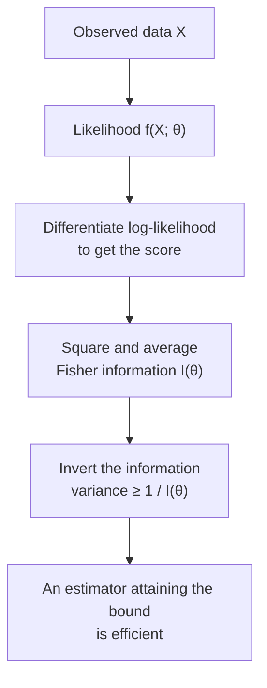

## TL;DR

- C. R. Rao's 1945 paper independently established the lower bound now called the Cramér–Rao bound, alongside work by Aitken, Silverstone, Fréchet, Darmois, and Cramér.
- For estimators that are right on average, and models satisfying the theorem's assumptions, the data imposes a floor on how much repeated estimates can scatter.
- The same paper showed how to improve an estimate by averaging away irrelevant variation, and how to measure distances between nearby probability distributions.
- Natural-gradient methods reuse the Fisher geometry, but that does not mean neural-network training is directly trying to attain the CRLB.
- The demo shows an efficient sample mean tracking the bound and a deliberately inefficient estimator remaining above it.

There is a theorem that sits so far below most machine learning curricula that I had never heard of it by name until I started reading backwards from the things I was using. I knew what a maximum likelihood estimator was. I knew, dimly, that it was "optimal." I didn't know what that meant.

The claim comes from a paper published in 1945 in the *Bulletin of the Calcutta Mathematical Society*. The author was Calyampudi Radhakrishna Rao, who was 24 years old, had been at the Indian Statistical Institute for roughly four years, and was answering a student's question when he derived the central result. [International Prize in Statistics, 2023](https://statprize.org/2023/04/01/eminent-statistician-c-r-rao-awarded-2023-international-prize-in-statistics/)

He named his autobiography *Statistics as a Last Resort*.

---


## From a failed job search to a theorem

Rao finished his B.A. in mathematics at Andhra University in 1940, first in his class, and then hit a wall. He applied for a research scholarship, didn't get it, submitted late. He applied for other jobs. Nothing.

He arrived in Calcutta during the war, by chance met someone training at the Indian Statistical Institute, and applied for their one-year course as a fallback. [Bhāvanā, "C.R. Rao: A Life in Statistics"](https://bhavana.org.in/c-r-rao-a-life-in-statistics/)

Mahalanobis accepted him. Rao completed his M.A. in statistics from Calcutta in 1943, again first in the class, and joined ISI full time. The institute at that point was Mahalanobis's project, a place doing survey work, census work, agricultural experiments, not obviously a home for pure mathematical statistics. But the environment was unusually serious, and Rao's own account suggests he was restless with just the applied side.

By 1945 he had published a paper that contained, in eleven pages (81–91), three distinct results that would still be in active use eighty years later.

Those three results address different questions: how precise an estimate can be, how to improve one, and how to measure change between probability distributions.

---

## The question, the floor

Start with the problem as a working statistician faces it. You have a probability distribution with an unknown parameter θ, say, the mean of a Gaussian, or the bias of a coin. You observe some data. You want to *estimate* θ from the data. You have enormous freedom here: you can use the sample mean, the sample median, the midpoint of the range, any function of the observations you like. The natural question is how good these estimators can be.

The unknown **parameter** $\theta$ is a fixed number; the **estimator** $\hat{\theta}$ is the rule applied to random data, and therefore changes from sample to sample. An estimator is **unbiased** if those repeated estimates average to the true value. Its **variance** measures how widely they scatter around that average. Small variance means that repeating the experiment gives similar answers.

So "good" here means precise without being systematically off target. And the question that should follow immediately is: is there a limit to how precise an unbiased estimator can be? Or could you always, in principle, do better?

Here is what Rao proved (independently, and nearly simultaneously, also proved by Fréchet in 1943 and Darmois in 1945, and later by Cramér in his 1946 textbook, more on this in a moment): the answer is yes, there is a hard limit.

Under the theorem's regularity conditions, an unbiased estimator $\hat{\theta}$ of $\theta$ satisfies the following inequality. Here $I(\theta)$ refers to the information in the entire observed sample, not one observation:

$$
\operatorname{Var}(\hat{\theta}) \geq \frac{1}{I(\theta)}
$$

The **Fisher information** measures the model's sensitivity to the unknown parameter. Here $f(X;\theta)$ says how plausible the observed data $X$ would be for a proposed value of $\theta$; viewed as a function of $\theta$, it is the **likelihood**. Taking its logarithm turns products across observations into sums. The derivative asks how quickly that log-likelihood changes as the proposed parameter moves, and is called the **score**. The expectation $\mathbb{E}$ means its long-run average under the model. Square that score and average it under the model:

$$
I(\theta) = \mathbb{E}\left[
\left(\frac{\partial}{\partial\theta}\log f(X;\theta)\right)^2
\right]
$$

If the likelihood changes sharply around the true $\theta$, nearby parameter values are easy to distinguish and Fisher information is high. If it barely changes, information is low. More information pushes $1/I(\theta)$ down, allowing a more precise unbiased estimate.



This is the Cramér–Rao lower bound (CRLB). An estimator that achieves it, Var(θ̂) = 1/I(θ), is called **efficient**. [Cramér–Rao bound](https://en.wikipedia.org/wiki/Cram%C3%A9r%E2%80%93Rao_bound)

For the demo's concrete case, $n$ observations come from a normal distribution with unknown mean $\mu$ and known variance $\sigma^2$. Each observation contributes $1/\sigma^2$ information, so independent observations add:

$$
I(\mu)=\frac{n}{\sigma^2}
\qquad\Longrightarrow\qquad
\operatorname{Var}(\hat{\mu})\geq\frac{\sigma^2}{n}
$$

The sample mean has variance exactly $\sigma^2/n$. It reaches the floor rather than merely approaching it, which is why it is efficient in this model. If each measurement has standard deviation 2, its variance is 4. With 100 independent measurements, the mean's variance is $4/100=0.04$, so its standard deviation is 0.2: ten times smaller than that of one measurement.

The assumptions matter. The usual derivation requires enough smoothness to differentiate averages, finite Fisher information, and appropriate control of the model's possible observations. An unknown endpoint of a uniform distribution needs separate treatment. A biased estimator is outside this particular bound too: always returning zero has zero variance, but can be consistently wrong. [Berkeley Stat 210A, score and Fisher information](https://stat210a.berkeley.edu/fall-2025/reader/score-fisher.html)


In the animation, the experiment is repeated many times and both estimates pile up around μ. The first measurement scatters with standard deviation σ, the average of five with σ/√5. As each experiment uses 5, then 20, then 100 measurements, the floor drops as 1/n and the average's spread sits exactly on it, while the first measurement stays as wide as before. The dots are seeded simulated draws with σ² = 1. The curves and the gold bracket, one standard deviation at the floor, are exact model values.


The maximum likelihood estimator is asymptotically efficient in regular parametric models: after suitable scaling, its asymptotic variance reaches the inverse Fisher information. That's one precise meaning behind the vague claim that "MLE is optimal." Not always, not in every model, and not in every sense.

Cramér independently developed the information inequality in his 1946 textbook *Mathematical Methods of Statistics*. Earlier related versions appeared in work by Aitken and Silverstone (1942), Fréchet (1943), and Darmois (1945). The name does not tell the full discovery history. The full genealogy sometimes appears as the **Fréchet–Darmois–Cramér–Rao inequality**, which is accurate but unwieldy. [Fréchet–Darmois–Cramér–Rao inequality](https://proofwiki.org/wiki/Fr%C3%A9chet-Darmois-Cram%C3%A9r-Rao_Inequality)

For several unknown parameters, $\theta$ becomes a vector and Fisher information becomes a matrix. The bound then compares covariance matrices. It does not compare entries one by one: it says that every linear combination of the estimated parameters has at least the corresponding variance supplied by the inverse information matrix, when that matrix is invertible. Rao's paper also linked Fisher information to geometry.

---

## The follow-up question: can you get there from a bad starting point?

Knowing there is a floor is useful. Knowing how to reach it is a different problem. And the second result in the same 1945 paper addresses exactly that: if you already have an estimator, maybe a mediocre one, inherited from somewhere, can you improve it, and how?

The answer is conditioning. A **sufficient statistic** for θ is a compressed summary $T(X)$ that loses no information about θ. For normal data with known variance, the sample mean is sufficient for the unknown mean: once it is known, the remaining arrangement of observations says nothing further about $\mu$.

Rao proved that you can improve an unbiased estimator $\delta(X)$ by averaging it over all datasets with the same sufficient summary:

$$
\delta^*(T)=\mathbb{E}[\delta(X)\mid T(X)]
$$

The vertical bar means "given that $T(X)$ is known." The new estimator remains unbiased and has variance no larger, and usually smaller, than the original. For this variance comparison, assuming finite variances, conditioning on a sufficient statistic never makes you worse. [Berkeley Stat 210A, Rao–Blackwell theorem](https://stat210a.berkeley.edu/fall-2025/reader/unbiased-estimation.html)

Take the demo's deliberately wasteful estimator: return the first observation $X_1$ and ignore the others. Now condition on the sample mean $\bar X$. Once that average is fixed, no observation has a privileged position, so the conditional average of $X_1$ is $\bar X$ itself. For the normal model above,

$$
\mathbb{E}[X_1\mid\bar X]=\bar X.
$$

We have turned the one-measurement estimator into the sample mean, reducing its variance from $\sigma^2$ to $\sigma^2/n$. Averaging here means averaging over the uncertainty left after the summary is known, not collecting new measurements.

David Blackwell proved the same result independently in 1947, when he was at Howard University. The theorem carries both names. Lehmann and Scheffé coined "Rao–Blackwell theorem" in 1950; Berkson called the process "Rao–Blackwellization" in 1955. The technique matters now in Monte Carlo methods and particle filtering: a computational statistician who improves an estimate by conditioning on available structure is doing Rao–Blackwellization, whether or not they call it that. [Rao–Blackwell theorem](http://www.scholarpedia.org/article/Rao-Blackwell_theorem)

Blackwell deserves the separate mention: he was the first African American to earn a mathematics PhD at the University of Illinois (1941) and the first Black inductee to the National Academy of Sciences. [University of Illinois, Blackwell profile](https://stat.illinois.edu/news/2020-07-17t141901/david-h-blackwell-profile-inspiration-and-perseverance) Two people, from very different circumstances, found the same structural truth in the same window of time.

Rao–Blackwell does not promise to reach the CRLB. It promises an estimate with no greater variance; the bound itself need not be attainable.

---

## The same question, applied to geometry, testing, and design

The third result in the 1945 paper literally was a footnote. Rao showed that Fisher information defines a **Riemannian metric**: a local ruler that can change from one point of a curved space to another. Here the "points" are probability distributions, and the ruler measures how distinguishable nearby distributions are.

This is the seed of **information geometry**, developed by researchers including Shun-ichi Amari. A **manifold** is a space that looks like ordinary coordinates when you examine a small neighbourhood; its **metric tensor** supplies the local distance rule. Here a step matters according to how much it changes the predicted distribution, rather than just the parameter numbers.

The **natural gradient** adjusts the ordinary downhill direction using the inverse Fisher information matrix. K-FAC (Kronecker-factored approximate curvature) makes that expensive calculation more manageable by approximating matrix blocks with smaller factors. These are uses of Fisher geometry, not attempts to make neural-network prediction error attain the CRLB. [Amari, 2019](https://proceedings.mlr.press/v89/amari19a.html); [Martens and Grosse, 2015](https://proceedings.mlr.press/v37/martens15.html)

So the same object, Fisher information, the denominator in the CRLB, turns out to govern not only the floor on variance but also the shape of the space you're optimizing over. Rao left that in a footnote and then Amari built a field out of it.

Rao's later work also reached hypothesis testing and experimental design. Those deserve their own worked examples; the thread here is narrower: Fisher information supplies a variance benchmark, conditioning can improve an estimator, and the same information defines a local ruler between probability distributions.

---

## The bound inside your model

The CRLB remains a live benchmark in parametric estimation problems such as localization, radar, and sensor calibration, when its unbiasedness and regularity assumptions apply. That is narrower than saying every prediction made by a neural network has a CRLB. House-price prediction or protein-structure prediction does not automatically fit this setup.

Natural-gradient and K-FAC methods make a different use of the Fisher information: they use it to define or approximate the geometry of an optimization step.

Rao died on 22 August 2023, at 102, in Amherst, New York. [Penn State obituary](https://www.psu.edu/news/eberly-college-science/story/emeritus-professor-cr-rao-world-renowned-statistician-dies-102) The International Prize in Statistics, the field's closest equivalent to a Nobel, reached him in April 2023, announced before he died, presented in July at the International Statistical Institute World Statistics Congress in Ottawa. He received it for work done seventy-eight years prior. The prize came with $80,000. I'm not sure what the right word for that timeline is. [International Prize in Statistics](https://statprize.org/2023/04/01/eminent-statistician-c-r-rao-awarded-2023-international-prize-in-statistics/)

The last post in this arc covered Mahalanobis, who built the institute and the school. This one covers the student Mahalanobis accepted when no one else would, who sat in that school, answered a question in a class, and helped establish how precise an unbiased estimate could be under a specified statistical model.

Some floors don't move.

---

## See it in practice

The code in `code/crlb_demo.py` runs a Monte Carlo demonstration: estimate the mean of a Gaussian from many samples, compare the sample mean with an unbiased estimator that uses only the first observation, and measure both empirical variances. The sample mean tracks 1/I(θ); the wasteful estimator stays well above it.

```text
     n        CRLB    Mean Var  Mean/Bound  First-X Var  First/Bound
---------------------------------------------------------------------
     5    0.200000    0.200851       1.0043     1.001149         5.01
    20    0.050000    0.049961       0.9992     0.998617        19.97
   100    0.010000    0.010021       1.0021     1.000740       100.07
  1000    0.001000    0.000998       0.9978     1.003978      1003.98
```

The sample-mean ratios hover around 1.0. Some finite Monte Carlo estimates fall slightly below it because the measured variance is itself noisy; the theorem constrains the true variance, not every simulation estimate.

---


Run the Monte Carlo simulation in `code/crlb_demo.py` and adjust the sample sizes. Try returning a fixed constant too: its zero variance does not beat the theorem because it is biased. Report a failure only after checking the model, unbiasedness, and Monte Carlo uncertainty.

## Get the code

[Download the demo ZIP](/blog/assets/code/the-floor-beneath-every-estimate/the-floor-beneath-every-estimate.zip) · [View source on GitHub](https://github.com/Sukalyan2003/Sukalyan2003.github.io/tree/main/blog/assets/code/the-floor-beneath-every-estimate)

Extract the ZIP and open the `the-floor-beneath-every-estimate` folder, then run:

```bash
python3 -m pip install -r code/requirements.txt
python3 code/crlb_demo.py
```

The `code/README.md` includes the test command and expected output.

## Sources and further reading

- Rao, C. R. (1945). "Information and the accuracy attainable in the estimation of statistical parameters." *Bulletin of the Calcutta Mathematical Society*, 37, 81–91. [SCIRP reference](https://www.scirp.org/reference/referencespapers?referenceid=1366410)
- International Prize in Statistics 2023 announcement, [statprize.org](https://statprize.org/2023/04/01/eminent-statistician-c-r-rao-awarded-2023-international-prize-in-statistics/)
- ISI Web, award announcement, [isi-web.org](https://isi-web.org/article/eminent-statistician-cr-rao-awarded-2023-international-prize-statistics)
- Wikipedia, "C. R. Rao", [en.wikipedia.org](https://en.wikipedia.org/wiki/C._R._Rao)
- Wikipedia, "Cramér–Rao bound", [en.wikipedia.org](https://en.wikipedia.org/wiki/Cram%C3%A9r%E2%80%93Rao_bound)
- Wikipedia, "David Blackwell", [en.wikipedia.org](https://en.wikipedia.org/wiki/David_Blackwell)
- Wikipedia, "Score test", [en.wikipedia.org](https://en.wikipedia.org/wiki/Score_test)
- Bhāvanā, "C.R. Rao: A Life in Statistics", [bhavana.org.in](https://bhavana.org.in/c-r-rao-a-life-in-statistics/)
- Deccan Chronicle (2020), "C R Rao turns 100: A statistician by chance", [deccanchronicle.com](https://www.deccanchronicle.com/opinion/op-ed/100920/c-r-rao-turns-100-a-statistician-by-chance.html)
- Scholarpedia, "Rao–Blackwell theorem", [scholarpedia.org](http://www.scholarpedia.org/article/Rao-Blackwell_theorem)
- Scholarpedia, "Rao score test", [scholarpedia.org](http://www.scholarpedia.org/article/Rao_score_test)
- ArXiv 2406.19956, "Three Scores and 15 Years (1948-2023) of Rao's Score Test", [arxiv.org](https://arxiv.org/abs/2406.19956)
- Amari (2019), "Fisher Information and Natural Gradient Learning in Random Deep Networks," PMLR, [proceedings.mlr.press](https://proceedings.mlr.press/v89/amari19a.html)
- Orthogonal Arrays review (2025), [arxiv.org](https://arxiv.org/html/2505.15032v1)
- HandWiki, "Cramér–Rao bound", [handwiki.org](https://handwiki.org/wiki/Cram%C3%A9r%E2%80%93Rao_bound)
- ProofWiki, "Fréchet–Darmois–Cramér–Rao Inequality", [proofwiki.org](https://proofwiki.org/wiki/Fr%C3%A9chet-Darmois-Cram%C3%A9r-Rao_Inequality)

- [Berkeley Stat 210A, Score Function and Fisher Information](https://stat210a.berkeley.edu/fall-2025/reader/score-fisher.html).
- [Berkeley Stat 210A, Unbiased Estimation](https://stat210a.berkeley.edu/fall-2025/reader/unbiased-estimation.html).
- [Martens and Grosse (2015), Optimizing Neural Networks with Kronecker-factored Approximate Curvature](https://proceedings.mlr.press/v37/martens15.html).
- [NIST, Confounding (also called aliasing)](https://www.itl.nist.gov/div898/handbook/pri/section3/pri3343.htm).
- [University of Illinois, David H. Blackwell profile](https://stat.illinois.edu/news/2020-07-17t141901/david-h-blackwell-profile-inspiration-and-perseverance).
- [Penn State, C. R. Rao obituary](https://www.psu.edu/news/eberly-college-science/story/emeritus-professor-cr-rao-world-renowned-statistician-dies-102).
