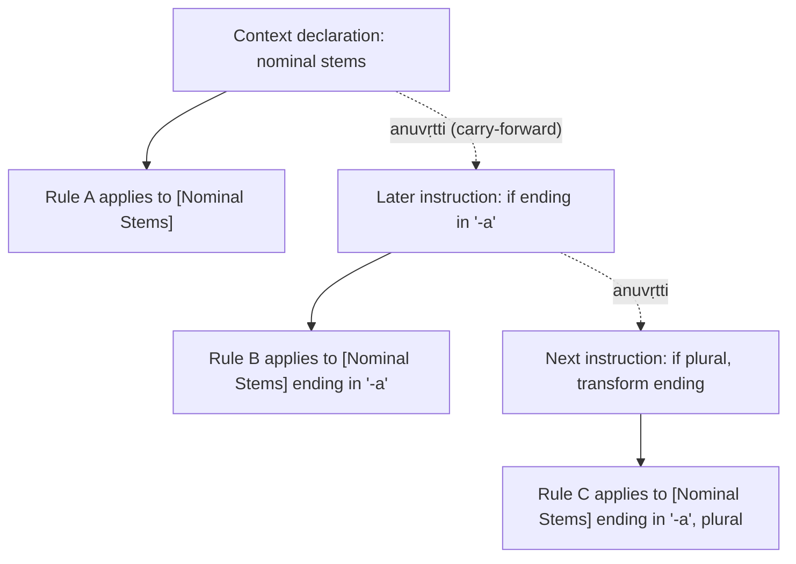
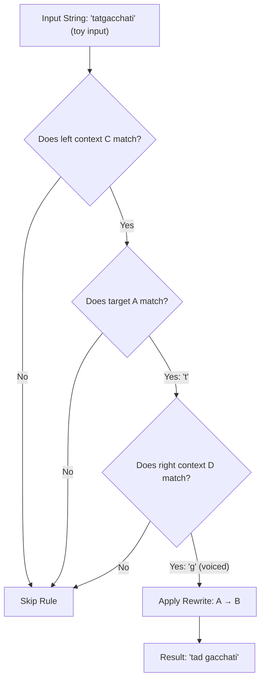
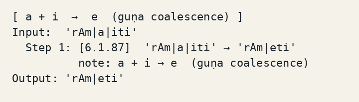

## TL;DR

- Pāṇini's Aṣṭādhyāyī describes Sanskrit forms through a compact system of rules and rules about rules.
- It names groups of sounds, carries conditions between rules, and controls which changes other rules can see.
- These structures invite comparisons with programming languages, but a similarity is not proof of historical influence or identical expressive power.
- Rishi Rajpopat's 2022 thesis proposes a different reading of a conflict rule; it does not prove that every part of the grammar is internally consistent.
- The Python demo implements a small rewrite engine, not the full Sanskrit grammar.

My linguistic knowledge is limited. I have a CS background and a passing interest in Sanskrit, but I am not a trained linguist. Corrections and clarifications are welcome.

> **Project status:** The `code/panini_engine.py` script is a minimal rewrite-rule engine demonstrating structural ideas like rule ordering and context-sensitivity. It handles simplified sandhi rules successfully. It is an educational toy, not a full implementation of the Aṣṭādhyāyī.

The first time I read a technical description of how the Aṣṭādhyāyī works, I had to stop and reread it twice. It read, almost word for word, like a description of a compiler with Context-sensitive rules, a metalanguage for describing the object language, Ordered rule application, and a conflict-resolution hierarchy. A **metalanguage** is the notation used to describe another language: the rule labels and instructions, rather than the Sanskrit forms they generate.

Sometime around [350 BCE](https://en.wikipedia.org/wiki/P%C4%81%E1%B9%87ini), in the Gandhara region of what is now northern Pakistan, a grammarian named Pāṇini compiled a compact, highly structured description of Sanskrit. He called it the Aṣṭādhyāyī, or "Eight Chapters." It contains [3,959 sūtras](https://en.wikipedia.org/wiki/P%C4%81%E1%B9%87ini), each one a terse instruction, most of them three or four syllables long. The whole thing was designed to be memorized and recited, not written down.

* * *

## Not really a textbook

Sanskrit was a language of ritual, scholarship, and literary expression. Pāṇini's grammar treats both Vedic and contemporary usages; reducing its purpose to preserving a language nobody spoke would miss part of the project.

The religious stakes were absolute: Vedic rituals required exact phonetic precision. If the pronunciation drifted, the ritual failed.

As the daily spoken languages (Prakrits) evolved away from Vedic Sanskrit, the need for an airtight method to preserve and generate the correct archaic forms became an existential necessity.

There were already earlier grammarians and Pāṇini names [ten of them](https://en.wikipedia.org/wiki/P%C4%81%E1%B9%87ini). But their treatments were partial or inconsistent, and the language had accreted enormous complexity: vowel changes at word boundaries, consonant mutations before certain sounds, hundreds of verb roots each with their own inflectional patterns.

Pāṇini's project was to specify Sanskrit *completely* in the smallest possible space. Not to teach it to beginners (the Aṣṭādhyāyī is notoriously opaque without prior training and years of absorbing context) but to describe forms through a compact network of rules, whose interpretation still requires substantial grammatical knowledge.

* * *

## Glossary of the Engine

Before we dive in, here are the key operational concepts Pāṇini used. Think of these as the fundamental operations of his rule engine:

*   **Pratyāhāra:** Character classes. Instead of listing "a, e, i, o, u", you use a start and end marker to define a continuous sequence of sounds.

*   **Anuvṛtti:** State carry-forward or ellipsis. A later rule can inherit material stated earlier. Variable scope is a useful programming analogy, not an exact identity.

*   **Samjñā:** Explicit definitions or variables assigned to specific concepts.

*   **Asiddha:** "As if not done." A pipeline ordering semantic where a rule executes but its output is hidden from certain earlier rules.


* * *

## A phoneme list data structure

A **phoneme** is a contrasting speech sound. Pāṇini's first move was to compress the sound inventory itself. Prefixed to the Aṣṭādhyāyī are 14 short verses, the Śivasūtras, listing the Sanskrit sounds in a specific, non-alphabetical order. It lets recurring groups of sounds be named compactly rather than listed each time.

A short vowel followed by a "dummy" marker letter becomes a *pratyāhāra*, an abbreviation for all sounds between those two points in the list. "AC" means all vowels. "HAL" means all consonants. If you need a rule that applies to any vowel following any consonant, you write it once using pratyāhāras; you don't enumerate all the combinations.

The pratyāhāra system directly parallels what a regex engine does with `[aeiou]`.

You cannot reorder the Śivasūtras without breaking hundreds of pratyāhāras elsewhere in the grammar, which means the grammar's opening 14 lines are load-bearing in the most literal possible sense. This is a data structure.

The second move is *anuvṛtti* or carry-forward. A later sūtra can omit elements already established by an earlier one, relying on the derivation process to supply the missing material from context. This is grammatical ellipsis, systematic and precise.

Here is a schematic comparison with scope: later instructions reuse a declared context. These are invented labels, not quotations or numbers from the Aṣṭādhyāyī:



The saving comes from not repeating the same conditions in every instruction. The reader reconstructs what an isolated rule leaves unstated.

The third move is to distinguish what different kinds of rule do. Calling this a type system is an analogy; it does not imply the checks performed by a programming-language type checker. Pāṇini distinguishes six kinds of sūtra: definitions (*samjñā*), general rules (*vidhi*), restrictions (*niyama*), analogy rules (*atideśa*), governing rules (*adhikāra*), and metarules (*paribhāṣā*). The governing rules establish a domain: "the following rules, until further notice, apply only to nominal stems ending in -a."

The metarules specify how to read everything else.

* * *

## Validity of the comparisons

Most of the Aṣṭādhyāyī's productive rules follow the pattern: **A → B / C \_ D**. Replace A with B when it appears in left-context C and right-context D. If you've ever written a context-sensitive grammar, or a regular-expression substitution with lookahead and lookbehind, you already know this shape.



A real example, simplified: a word-final *t* becomes *d* when the next word starts with a voiced consonant. "tat gacchati" → "tad gacchati." The rule fires *because of context*: strip the following word and nothing happens. The engine in `code/panini_engine.py` models a simplified version on concatenated ASCII input such as `tatgacchati`: each rule carries optional left and right constraints, and only triggers when both are satisfied.

The ordering of rules matters too. When two rules could both apply, the Aṣṭādhyāyī uses a priority hierarchy: exceptions (*apavāda*) override general rules (*utsarga*). More specialized rules beat more general ones. If you've set parser precedence in yacc, or wrestled with CSS specificity, the engineering problem will be familiar: several transformations may be eligible, and a policy must choose between them. That comparison does not settle every grammatical conflict.

The **asiddha** relation, "not effected," controls visibility between operations. Under rule 8.2.1, the final three sections, called the *Tripādī*, are treated as not effected with respect to preceding rules. A later operation's output cannot simply trigger an earlier operation as though all rules saw every change. This is a useful comparison with ordered transformation passes, not a claim that Sanskrit derivation is an ordinary compiler pipeline. [Joshi and Kiparsky, section 1](https://web.stanford.edu/~kiparsky/Papers/siddha.new.pdf)

The point where this system diverges from being a compiler analogue is that: all of this still requires a human to execute it.

Modern implementations cover subsets and make explicit interpretive choices; this toy does much less.

The rules specify *what to do* with precision. *Doing it* requires tracking derivation state, choosing which rules are currently in scope, and resolving conflicts according to the metarule hierarchy. That's cognition, not compilation.


---

## A disputed instruction about competing rules

The metarule *1.4.2 vipratiṣedhe paraṁ kāryam* concerns competing rules. Its familiar interpretation gives precedence to the later rule. In his [2022 Cambridge thesis](https://www.repository.cam.ac.uk/handle/1810/332654), Rishi Rajpopat instead argues for a right-side preference in the conflicts he examines: where rules apply to the two sides of a word, prefer the operation on the right.

That is a proposed interpretation supported by worked derivations. It is not a proof that every rule in the Aṣṭādhyāyī is consistent, that every Sanskrit form has a unique derivation, or that implementing the entire grammar is now straightforward. Nor would a disputed interpretation make the whole system cease to be formal. The compiler comparison is useful without asking one thesis to settle all those questions.

## Why BNF should be called Pāṇini-Backus Form, and why it isn't

In 1959, John Backus developed a notation for specifying the syntax of ALGOL 58. Peter Naur formalized it for ALGOL 60. This became Backus-Naur Form: the standard metalanguage for describing programming language grammars.

In March 1967, Peter Ingerman published a [one-page note in *Communications of the ACM*](https://dl.acm.org/doi/10.1145/363162.363165) suggesting the name be changed to "Pāṇini-Backus Form." His argument: Pāṇini had developed a notation of equivalent expressive power roughly 2,300 years earlier, and Backus (though he discovered BNF independently) was not the first. Ingerman wanted the name to reflect that.

Both formalisms use substitution rules to describe strings, both separate the metalanguage from the object language, both are generative. The structural similarity is real.

What it is not: evidence of historical influence. Backus had never studied Sanskrit grammar. The parallel is two people solving the same structural problem with structurally similar solutions: independent discovery, not transmission.

The same applies to Chomsky. In his [1965 *Aspects of the Theory of Syntax*](https://en.wikipedia.org/wiki/Aspects_of_the_Theory_of_Syntax), Chomsky wrote that "it seems that even Pāṇini's grammar can be interpreted as a fragment of such a 'generative grammar,' in essentially the contemporary sense of this term." This is Chomsky recognizing the parallel, not crediting an influence. His generative grammar program developed from American structuralism and mathematical logic. Multiple sources repeat a claim that Chomsky called Pāṇini's grammar "the first modern generative grammar"; the documented primary source is the 1965 citation, which is more careful than that.

---

## The formal claim

The comparisons that hold are concrete: a finite collection of rules generates forms; special notation describes the language; conditions depend on surrounding material; and metarules govern interaction between operations.

A context-dependent rewrite does not, by itself, establish where the resulting language belongs in the **Chomsky hierarchy**, a classification by what kinds of formal grammar or machine can describe a language. That would require an explicit formalization and an expressive-power argument. The toy engine establishes neither.

They are structural features of the Aṣṭādhyāyī that happen to recur in formal language theory two millennia later.

---

## "First grammar" undersells it by about 2,000 years of precision

The Aṣṭādhyāyī gets described as "the world's first grammar" in popular writing. That priority claim obscures the more useful question: what kind of grammatical description is it? A grammar in the ordinary sense is a book that tells you what's correct. What Pāṇini wrote is a *formal specification of a natural language*: compact rules, technical notation, and a system for relating instructions to one another.

There is nothing else like it from the ancient world. Aristotle's logical works are formal, but they describe reasoning, not language. The Stoics studied syntax but didn't formalize it this way. The closest analogue isn't any other ancient grammar. It's the kind of object a theoretical computer scientist would write if asked to specify a natural language in a proof.

Pāṇini did this roughly 2,400 years before anyone had the mathematical vocabulary to describe what kind of object it is.


Two semesters of Theory of computation and Compiler design never once mentioned any of this, and weirdly enough, learning about it now, I have a better appreciation of the content of those classes. This provides a kind of context that's perfect for fueling up one's curiosity.

Pāṇini did not build a compiler. But the idea that formal specification of language structure was a Western innovation of the 20th century doesn't hold up with the presence of the Aṣṭādhyāyī.

I hope my explanations survive the scrutiny of Sanskrit scholars. I am not one, and I welcome corrections and clarifications.

---

## Run the toy engine

The code in `code/panini_engine.py` is a minimal Python rewrite-rule engine demonstrating the structural ideas above: rule ordering, context-sensitivity, apavāda priority, derivation traces. It is a toy implementation. It handles a handful of simplified Sanskrit sandhi rules and gets them right. It does not implement the Aṣṭādhyāyī.

Have you tried running the toy engine, or do you have thoughts on the structural convergences? Open an issue in the repo if you'd like to see more complex rules implemented, or drop a comment below.

To understand what the engine is doing without reading the code, let's look at a simple rule: a word-final *t* becomes *d* when the next word starts with a voiced consonant (`tat gacchati` → `tad gacchati`). The engine checks the input string. It scans for a `t`. Once it finds it, it looks ahead to see if the next letter is voiced (like `g`). If both conditions are met, the engine rewrites the `t` into a `d` and outputs the new string. It's a simple find-and-replace, but with strict boundary conditions.

```python
# Simplified example of 6.1.87: a + i → e (guṇa coalescence)
Rule(
    name="6.1.87",
    target="a|i",
    replace="e",
    note="a + i → e  (guṇa coalescence)",
    priority=10,
)
```

Running it:

```text
[ a + i  →  e  (guṇa coalescence) ]
Input:  'rAm|a|iti'
  Step 1: [6.1.87]  'rAm|a|iti' → 'rAm|eti'
          note: a + i → e  (guṇa coalescence)
Output: 'rAm|eti'
```

The *i+i* and *u+u* examples illustrate homogeneous vowel lengthening under 6.1.101. The *a+i* and *a+u* examples illustrate guṇa under 6.1.87. These patterns do not compete in the toy, so their priority numbers do not demonstrate apavāda. Separate, explicitly invented rules exercise priority when two patterns do match. [Sandhi rules and their text](https://www.learnsanskrit.org/vyakarana/sounds/ac-sandhi/)

For the full engine and tests: `code/README.md`.



---

## Get the code

[Download the demo ZIP](/blog/assets/code/the-grammar-that-runs-like-a-program/the-grammar-that-runs-like-a-program.zip) · [View source on GitHub](https://github.com/Sukalyan2003/Sukalyan2003.github.io/tree/main/blog/assets/code/the-grammar-that-runs-like-a-program)

Extract the ZIP and open the `the-grammar-that-runs-like-a-program` folder. The `code/README.md` includes the run and test commands.

## Sources and further reading

- Rishi Rajpopat, "In Pāṇini We Trust: Discovering the Algorithm for Rule Conflict Resolution in the Aṣṭādhyāyī," Cambridge PhD thesis, 2022. [Cambridge repository](https://www.repository.cam.ac.uk/handle/1810/332654)
- Peter Ingerman, "Pāṇini-Backus form suggested," *Communications of the ACM* 10(3), p. 137, March 1967. [ACM DL](https://dl.acm.org/doi/10.1145/363162.363165)
- John Kadvany, "Pāṇini's Grammar and Modern Computation," *History and Philosophy of Logic* 37(4), 2016. [Tandfonline](https://www.tandfonline.com/doi/abs/10.1080/01445340.2015.1121439)
- Saroja Bhate and Subhash Kak, "Pāṇini's Grammar and Computer Science," *Annals of the Bhandarkar Oriental Research Institute* 72(1–4), 1991. [PDF via LSU](https://www.ece.lsu.edu/kak/bhate.pdf)
- Wikipedia, "Pāṇini": https://en.wikipedia.org/wiki/P%C4%81%E1%B9%87ini (for dating discussion, the 3,959 sūtra count, and technical summary; well-cited)
- MacTutor History of Mathematics, "Panini": https://mathshistory.st-andrews.ac.uk/Biographies/Panini/
- The Wire Science, "How an Indian PhD Student Made Sanskrit's 'Language Machine' Work": https://science.thewire.in/education/sanksrit-language-machine-panini-grammar-rishi-rajpopat/
- learnsanskrit.org, "The Structure of the Ashtadhyayi": https://www.learnsanskrit.org/panini/structure/
- [Joshi and Kiparsky, The extended siddha-principle, section 1](https://web.stanford.edu/~kiparsky/Papers/siddha.new.pdf).
- [Learn Sanskrit, ac sandhi, quoted rule texts](https://www.learnsanskrit.org/vyakarana/sounds/ac-sandhi/).
