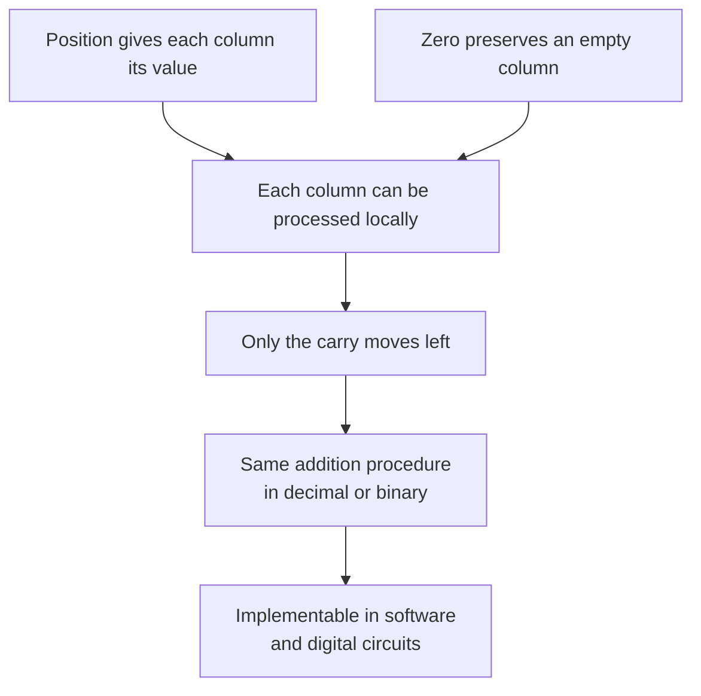

We all know this story. India invented zero. It spread west. The end.

The story we have in our heads was wrong in almost every interesting detail.

So. Let me tell you what actually happened.

---

## TL;DR
- Brahmagupta defined explicit arithmetic rules for zero in 628 CE, shifting it from a placeholder to a formal number.
- Place value and an explicit zero digit let an addition procedure handle one column at a time.
- The famous Bakhshali manuscript zero is a placeholder dot, not the fully realized arithmetic zero that makes modern computation possible.

> The `code/place_value.py` script implements base conversion and carry-propagating column addition in both decimal and binary, demonstrating exactly how a positional zero makes algorithmic arithmetic possible.

## What a zero placeholder is

The Babylonians had something zero-shaped by around 300 BCE. A scribal gap instead of a number. In their base-60 system, they needed to mark missing positions inside a numeral, so they eventually used two angled wedges for an empty internal column. This did not remove every ambiguity about overall scale. No symbol at the end of a number, and never used alone.  It was a typographical fix to an ambiguity problem. [Wikipedia, "0"](https://en.wikipedia.org/wiki/0)

The Maya had something even more developed, a shell glyph for zero, used in a vigesimal (base-20) positional system, attested by 36 BCE. Their calendrical and numerical use deserves its own history; it should not be dismissed as a lesser version of the Indian development. [Wikipedia, "0"](https://en.wikipedia.org/wiki/0)

The distinction is between a *placeholder* and a *number*.

A placeholder tells you: this column is empty, It's a formatting device.

A number participates in arithmetic: you can add it, subtract it, multiply by it, and you get predictable results.

Those traditions developed zero independently, with different notational and calendrical uses. The specific Indian contribution examined here is Brahmagupta's surviving written arithmetic rules, not a claim that every other culture had only a blank space. [MacTutor, zero](https://mathshistory.st-andrews.ac.uk/HistTopics/Zero/)

---

## Brahmagupta, 628 CE

Brahmagupta was born in 598 CE. By the time he was thirty, he had written the *Brāhmasphuṭasiddhānta*, "Correctly Established Doctrine of Brahma", a substantial astronomical and mathematical treatise. Chapter 18 is where the history of zero turns. [MacTutor, "Brahmagupta"](https://mathshistory.st-andrews.ac.uk/Biographies/Brahmagupta/)

He called positive numbers *dhana* (fortune) and negative numbers *ṛṇa* (debt). Zero he called *śūnya*, void, empty. He gave *śūnya* explicit arithmetic rules in a surviving mathematical text.

"The sum of a negative and zero is negative; [that] of a positive and zero is positive; [and that] of two zeros is zero." For multiplication: "the product of zero and a negative, of zero and a positive, or of two zeros is zero." [Wikipedia, "Brahmagupta"](https://en.wikipedia.org/wiki/Brahmagupta)

The move Brahmagupta made was to treat zero as *an element of the number system*, something you can operate on just like any other number, rather than as a gap in notation.

He also worked out negative number arithmetic: product of two negatives is positive, a fortune subtracted from zero gives a debt, a debt subtracted from zero gives a fortune. These rules let positive values, debts, and zero participate in the same arithmetic. That is the useful connection here; it does not require attributing modern abstract algebra to him.

Then he tried division by zero. He claimed that *0 ÷ 0 = 0*. This is wrong, division by zero is not well-defined, and it's a recognized error in an otherwise remarkable text. The MacTutor biography calls it "a brilliant attempt."

Later mathematicians continued to revisit division by zero. The point here is that giving zero arithmetic rules did not make every proposed rule correct.

---

## Aryabhata's fifty-nine words on place-value

Before Brahmagupta gave zero its arithmetic, Aryabhata had made the positional structure explicit. Aryabhata was born in 476 CE. In 499 CE, he notes he was 23 at the time, he wrote the *Aryabhatiya*. Chapter 1, second stanza: *sthānam sthānam daśa guṇam*, "from place to place, ten times in value." [Wikipedia, "Āryabhaṭa numeration"](https://en.wikipedia.org/wiki/%C4%80ryabha%E1%B9%ADa_numeration)

That's the whole principle. Everything about our number system follows from it: the reason 347 means 3×100 + 4×10 + 7×1, the reason 42 in binary means 1×32 + 0×16 + 1×8 + 0×4 + 1×2 + 0×1. It's a new idea about what *position means*.

Aryabhata himself didn't write a zero symbol, his own notation system used Sanskrit letters with vowels encoding place values, clever and extraordinarily compact, but not the symbol-based system we ended up with. The place-value principle was already operating in Indian mathematics by 499 CE. [Wikipedia, "Aryabhata"](https://en.wikipedia.org/wiki/Aryabhata)

These are distinct pieces of a longer development: a place-value principle, written digits including a zero sign, and arithmetic rules for zero. Aryabhata's letter notation and Brahmagupta's rules are important evidence, but adding their contributions together is not a complete history of the modern decimal numeral system.

---

## The Bakhshali manuscript

You may have seen headlines from 2017 announcing the discovery of the world's oldest zero, in a manuscript held at Oxford's Bodleian Library: the Bakhshali manuscript, a collection of birch-bark mathematical leaves found in 1881 near what is now Pakistan.

Oxford's radiocarbon dating of three folios produced dates of 224–383 CE, 680–779 CE, and 885–993 CE, three folios from three different centuries, in the same manuscript.

It means the 70 leaves were assembled from materials of different ages, which makes the "oldest" framing dubious from the start.

Scholars including Kim Plofker (whose *Mathematics in India*, Princeton 2009, is the standard scholarly treatment of this subject) criticized Oxford for releasing the findings through press releases and YouTube rather than peer review. [Smithsonian Magazine, 2017](https://www.smithsonianmag.com/smart-news/dating-ancient-indian-text-gives-new-timeline-history-zero-180964896/); [Wikipedia, "Bakhshali manuscript"](https://en.wikipedia.org/wiki/Bakhshali_manuscript)

A [2024 Oxford research record](https://ora.ox.ac.uk/objects/uuid:5a6d1dd7-f20c-4209-adb6-33849f5b08f4) reports revised radiocarbon work. The important limit remains: carbon dating measures the age of sampled bark, not directly the ink, every leaf, or the mathematical ideas.

What the Bakhshali zero actually is: a dot used as a placeholder within a positional grid, the *śūnya-bindu*, dot of the empty place. It marks an empty column. This is important and interesting evidence of the positional system in active use in Indian mathematical practice but not Brahmagupta's arithmetic zero. [Wikipedia, "Bakhshali manuscript"](https://en.wikipedia.org/wiki/Bakhshali_manuscript)

I'm telling you all this because the popular version of this story treats the Bakhshali manuscript as the smoking gun for "India invented zero first."

The dating and the interpretation of the dot need separate arguments; and even at the old dates, it doesn't predate the Babylonian placeholder. The real story, Brahmagupta giving zero arithmetic, is better than the headline.

---

## Making Arithmetic mechanical

What does it *actually* take to make arithmetic into an algorithm?

Consider adding 347 and 485 in Roman numerals. CCCXLVII + CDLXXXV. There is no direct place-aligned column algorithm in the numeral symbols themselves. That does not mean Roman arithmetic cannot be expressed as a procedure. You have to convert the subtractive prefixes to additive form, concatenate the letters, sort them by value, combine where possible, re-encode the result.

The system doesn't have columns or positions; there's no concept of carrying, because the symbols don't have place values. Each computation requires inspecting the whole numeral and knowing the full substitution rules. The Romans, when they needed to compute, used counting boards and then *wrote the result* in Roman numerals, the numerals themselves were for recording, not calculating. [ScienceBlogs, "Roman Numerals and Arithmetic"](https://scienceblogs.com/goodmath/2006/08/16/roman-numerals-and-arithmetic)

Now consider adding 347 and 485 in the positional system:

```text
  347
+ 485
-----
  7+5 = 12; write 2, carry 1
  4+8+1 = 13; write 3, carry 1
  3+4+1 = 8; write 8
= 832
```

Each column is *independent* given the carry from the column to its right. You never need to look at the whole number. When adding two non-negative integers in a base of at least two, the carry is zero or one and moves one column left. Adding more than two rows can require a larger carry. The process is local, right-to-left, terminating. It is an algorithm in the modern sense: a finite, deterministic procedure.



What makes this work?

Position determines magnitude, so column alignment is meaningful. And zero is a valid digit, an empty column is not a gap or an ambiguity but a genuine input to that column's calculation.

Strip the zero out of the system and you cannot uniquely represent numbers like 1024, 1204, and 1240, they collapse to the same digit list `[1, 2, 4]` with the zeros removed. The zero is load-bearing.

The code in `code/place_value.py` demonstrates this: base conversion between decimal and arbitrary bases (including binary), and the column addition algorithm running on digit lists with carry. Run it; you'll see 347 + 485 done in both base 10 and base 2 by the same function, same algorithm, different radix.

```python
# Same algorithm, base 10:
show_addition(347, 485, base=10)   # → 832

# Same algorithm, base 2:
show_addition(347, 485, base=2)    # → 1101000000 (= 832)
```

Binary is literally the same positional structure as Decimal with base 2 instead of base 10. The computer's adder circuits are built on the local, carry-propagating column algorithm. The reason you can implement addition in hardware, in gates, in silicon, is that each bit position needs only its two input bits plus one carry bit from the right. That locality comes from the positional structure. That positional structure, in the form the whole world uses, comes from India. [Wikipedia, "Positional notation"](https://en.wikipedia.org/wiki/Positional_notation)

---

## Baghdad, then Pisa, then everywhere

Brahmagupta's *Brāhmasphuṭasiddhānta* was written in 628. About 200 years later, a Persian mathematician named Muḥammad ibn Mūsā al-Khwārizmī, working in the House of Wisdom in Baghdad, wrote a treatise on Hindu numerals, *De numero Indorum* in its Latin title, that gave a full account of the Indian place-value system including zero. The text is described as likely based on an Arabic translation of Brahmagupta's work. [Britannica, "Al-Khwarizmi"](https://www.britannica.com/biography/al-Khwarizmi)

Al-Khwārizmī also wrote *Kitāb al-mukhtaṣar fī ḥisāb al-jabr wal-muqābala*, "The Compendious Book on Calculation by Completion and Balancing." The Arabic *al-jabr* from that title gives us "algebra." The Latinization of al-Khwārizmī's own name, *Algoritmi*, gives us "algorithm." Both words that define computational thinking trace back to the same man, who was transmitting Indian mathematics westward. [History of Information](https://historyofinformation.com/detail.php?id=202)

In 1202, Leonardo of Pisa, Fibonacci, published *Liber Abaci*. He had learned the Hindu-Arabic system studying in North Africa. His book opened: "The nine Indian figures are: 9 8 7 6 5 4 3 2 1. With these nine figures, and with sign 0 which the Arabs call zephir any number whatsoever is written." [Wikipedia, "Liber Abaci"](https://en.wikipedia.org/wiki/Liber_Abaci)

He called it *modus Indorum*, the method of the Indians.

The *Liber Abaci* made the practical case: positional arithmetic was simply faster and cheaper for commerce than Roman numerals. Italian merchants competing in Mediterranean trade needed to calculate, not just record, and the positional system let them do it without a counting board. That's the reason it spread: not scholarly consensus nor royal decree, simply economic pressure. [Wikipedia, "Liber Abaci"](https://en.wikipedia.org/wiki/Liber_Abaci)

---

## The nuance

The line I've seen on social media, in textbooks, and in well-meaning retrospectives: "India invented zero." It's not wrong, exactly. It's just not the sentence that earns the weight placed on it.

Zero had independent histories elsewhere, including Maya calendrical and numerical uses. A race to identify the first empty-place sign obscures the distinction between a written symbol and rules for operating on a number.

The distinctively Indian thing is: zero as a *number*, with arithmetic rules, in a place-value system capable of representing any integer with ten symbols, transmissible and learnable. Brahmagupta's rules, later arithmetic texts, trade, translation, and teaching all belong to that story. The modern system did not arrive fully formed in one act by one person.

A 7th-century mathematician in what is now Rajasthan figuring out the arithmetic of nothing, getting one answer wrong, and contributing arithmetic rules to a system that developed over centuries, doesn't need inflating.

---

Run the column addition algorithm in `code/place_value.py` with base 2 and base 10. If you can break the carry logic with a specific input, open an issue on the repository to let me know.

## Get the code

[Download the demo ZIP](/blog/assets/code/the-number-that-shouldn-t-exist/the-number-that-shouldn-t-exist.zip) · [View source on GitHub](https://github.com/Sukalyan2003/Sukalyan2003.github.io/tree/main/blog/assets/code/the-number-that-shouldn-t-exist)

Extract the ZIP and open the `the-number-that-shouldn-t-exist` folder. The `code/README.md` includes the run and test commands.

## Sources & further reading

1. Wikipedia, "Brahmagupta": https://en.wikipedia.org/wiki/Brahmagupta
2. Wikipedia, "0 (number)": https://en.wikipedia.org/wiki/0
3. Wikipedia, "Aryabhata": https://en.wikipedia.org/wiki/Aryabhata
4. Wikipedia, "Āryabhaṭa numeration": https://en.wikipedia.org/wiki/%C4%80ryabha%E1%B9%ADa_numeration
5. Wikipedia, "Bakhshali manuscript": https://en.wikipedia.org/wiki/Bakhshali_manuscript
6. Wikipedia, "Positional notation": https://en.wikipedia.org/wiki/Positional_notation
7. Wikipedia, "Liber Abaci": https://en.wikipedia.org/wiki/Liber_Abaci
8. MacTutor History of Mathematics, "Brahmagupta": https://mathshistory.st-andrews.ac.uk/Biographies/Brahmagupta/
9. MacTutor History of Mathematics, "Aryabhata I": https://mathshistory.st-andrews.ac.uk/Biographies/Aryabhata_I/
10. Oxford Bodleian Libraries, 2017 Bakhshali press release: https://www.glam.ox.ac.uk/article/carbon-dating-finds-bakhshali-manuscript-contains-oldest-recorded-origins-symbol-zero
11. Smithsonian Magazine, "Carbon Dating Reveals the History of Zero Is Older Than Previously Thought" (2017): https://www.smithsonianmag.com/smart-news/dating-ancient-indian-text-gives-new-timeline-history-zero-180964896/
12. Kim Plofker, *Mathematics in India*, Princeton University Press, 2009: https://books.google.ie/books/about/Mathematics_in_India.html?id=6nPfpOIUyAEC
13. Britannica, "Al-Khwarizmi": https://www.britannica.com/biography/al-Khwarizmi
14. History of Information, "Al-Khwārizmī Invents the Algorithm": https://historyofinformation.com/detail.php?id=202
15. ScienceOpen, "Brahmagupta and the Concept of Zero": https://www.scienceopen.com/hosted-document?doi=10.14293/S2199-1006.1.SOR-.PPDIJRA.v1
16. ScienceBlogs, "Roman Numerals and Arithmetic": https://scienceblogs.com/goodmath/2006/08/16/roman-numerals-and-arithmetic
- [Oxford research record, Radiocarbon dating of the Bakhshali manuscript](https://ora.ox.ac.uk/objects/uuid:5a6d1dd7-f20c-4209-adb6-33849f5b08f4).
- [MacTutor, A history of zero](https://mathshistory.st-andrews.ac.uk/HistTopics/Zero/).
