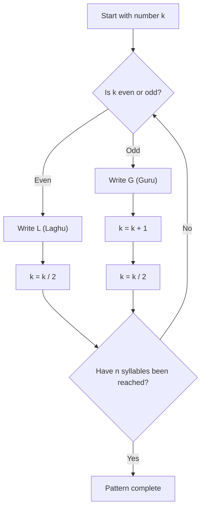
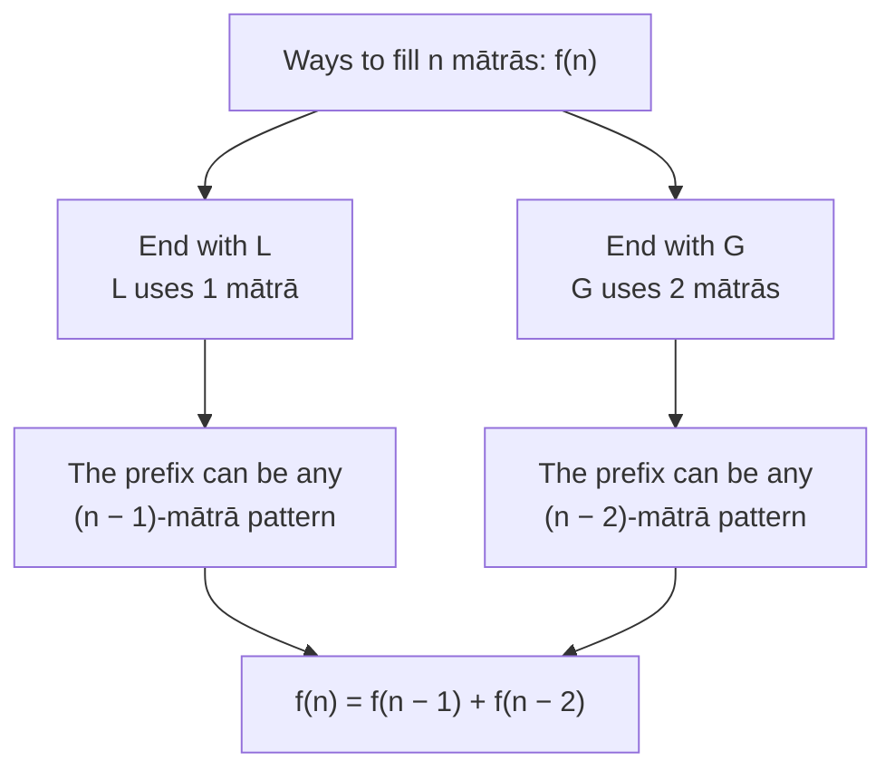

## TL;DR

- Piṅgala's prosody procedures enumerate every short-and-long syllable pattern in a structure equivalent to binary counting.
- Naṣṭa and uddiṣṭa convert between a pattern and its row without constructing the whole table.
- Halāyudha, not Piṅgala alone, made the Indian version of Pascal's triangle explicit.
- Fixing total mātrās instead of syllable count produces the recurrence later associated with Fibonacci.
- This is structural binary combinatorics, not evidence that Piṅgala used a binary numeral system.

Before Leibniz, before Boole, before any of the Western lineage that shows up in a CS curriculum, there was a Sanskrit prosodist, a scholar of poetic meter, who enumerated all the ways you can arrange short and long syllables in a line of verse, wrote down the conversion procedures for jumping between a pattern and its position number in the list, and arrived at a set of algorithms that are structurally indistinguishable from binary arithmetic.

---

## What was Pingala trying to solve?

Sanskrit poetry in the ancient world was oral. It was transmitted by memorization and recitation, and the meter of a poem - the rhythmic pattern of its syllables - was the main structural feature that made long texts memorable and verifiable.Get it right across ten thousand verses and you had the Mahābhārata.

Syllables in Sanskrit fall into two categories: *laghu* (L), short, worth one mātrā (mora); and *guru* (G), long, worth two mātrās. A meter is defined by how many syllables it has and which positions are L and which are G.

The Gāyatrī, the most sacred of Vedic meters, has 24 syllables across three lines of eight each.

The question a prosodist asks is: given a meter of length n, how many possible arrangements of L and G exist? And can you list them all? And if someone gives you a pattern, can you tell them which number in the list it is without listing everything first?

These are combinatorial questions, and Piṅgala's *Chandaḥśāstra* - eight chapters in the ultra-compressed sūtra style - answers all of them with algorithms. [[Wikipedia, Piṅgala](https://en.wikipedia.org/wiki/Pingala)]

The *Chandaḥśāstra* is not readable prose. It is terse aphoristic instructions, barely a few syllables per sūtra, requiring a trained interpreter and a commentary tradition to render operational.

That commentary tradition runs from Bharata in the early common era to Halāyudha in the 10th century CE - meaning Piṅgala's text spawned a thousand years of people working out what he meant.

The algorithms I'm about to describe are what that tradition extracted from his sūtras. [[Jayant Shah, "A History of Piṅgala's Combinatorics," University of Hyderabad](https://sanskrit.uohyd.ac.in/Algorithms_in_Ancient_India/Material/Pingala.pdf)]

---

## Six procedures, one by one

Piṅgala's system organizes around six pratyāya - procedural answers to specific questions about a meter of length n. [[Jayant Shah; Wikipedia, Sanskrit prosody](https://en.wikipedia.org/wiki/Sanskrit_prosody)]

**Prastāra** is the table.

It is a systematic listing of all possible patterns for n syllables, arranged in a specific order. For n = 3, there are 8 patterns, and Piṅgala's table begins with GGG (row 1) and ends with LLL (row 8). The order in between follows a regular rule: it is binary counting in descending order, with the leftmost syllable as the least-significant bit. GGG = 111 in binary, LGG = 110, GLG = 101, and so on down to LLL = 000. The table is the full enumeration. The code in `code/pingala.py` generates it exactly.

| Row | 1 | 2 | 3 | 4 | 5 | 6 | 7 | 8 |
|---|---|---|---|---|---|---|---|---|
| Pattern | GGG | LGG | GLG | LLG | GGL | LGL | GLL | LLL |
| Binary value | 111 | 110 | 101 | 100 | 011 | 010 | 001 | 000 |

If you take Piṅgala's prastāra for n syllables and write G = 1, L = 0, reading each row from right to left, you get the integers from 2ⁿ − 1 down to 0, in order. [[Chandrahas blogs, "Binary Conversion"; Indica Today, "Meru Prastaar"](https://chandrahasblogs.wordpress.com/2020/05/18/pingalas-algorithm-for-binary-conversion/)]

Row 5 in his table is not the number 4 in disguise. It is the meter GGL, a specific prosodic form with a name and a use in verse. The row numbers are labels. The place-value interpretation, with its implication that he understood numeric binary, came later.

**Saṅkhyā** is the count: the total number of patterns for n syllables is 2ⁿ. Piṅgala computes this by repeated doubling - add one syllable, double the count. Every combinatorics course covers this in the first week; Piṅgala arriving at it roughly 2,200 years earlier is notable but not astonishing once you accept that the problem itself forces you there.

The **least-significant bit** has weight one; the next has weight two, then four. Piṅgala's pattern convention places the weight-one position on the left, the reverse of the usual printed binary number.

**Naṣṭa** is the inverse lookup: given a row number k, find the pattern without constructing the whole table. Piṅgala's procedure (from sūtras 8.24–25, as interpreted by commentators): start with k. If k is even, write L and halve k. If k is odd, write G, add 1, then halve. Repeat n times. [[Indica Today, "Pingala's Algorithm Part IV"](https://www.indica.today/quick-reads/pingalas-algorithm-value-binary-sequences/)]

Here is a step-by-step trace of this algorithm running for $k = 4$ and $n = 3$:

| Step | Current `k` | Even/Odd? | Action | Output Syllable | Next `k` |
| :--- | :--- | :--- | :--- | :--- | :--- |
| 1 | 4 | Even | Write L, Halve | **L** | 2 |
| 2 | 2 | Even | Write L, Halve | **L** | 1 |
| 3 | 1 | Odd | Write G, +1, Halve | **G** | 1 |

Resulting Pattern: **L, L, G**

Here is the exact modern relationship. For row *k* in an *n*-syllable table, compute 2ⁿ − *k*, write it as an *n*-bit number, reverse the bits because Piṅgala's least-significant position is on the left, then map 0 to L and 1 to G. For row 4: 8 − 4 = 4 = 100₂; reversed, that is 001, or LLG. Naṣṭa reaches the same pattern without first constructing that binary value.

**Uddiṣṭa** runs backward: given a pattern, find its position. Piṅgala's rule: set value = 1, scan from rightmost to leftmost syllable; if L, double; if G, double then subtract 1. The result is the row number. This uses repeated doubling, the same arithmetic pattern as Horner's evaluation of a positional numeral, processing the most-significant position before the least-significant one - though Piṅgala has no explicit concept of place value or base. It works because the arithmetic happens to encode the right thing.

Here is a step-by-step trace running for the pattern **L, L, G** (read rightmost first: G, L, L):

| Step (Syllable) | Current Value | Action (L=Double, G=Double-1) | Next Value |
| :--- | :--- | :--- | :--- |
| Start | 1 | - | 1 |
| 1 (**G**) | 1 | Double, subtract 1 ($2 \times 1 - 1$) | 1 |
| 2 (**L**) | 1 | Double ($2 \times 1$) | 2 |
| 3 (**L**) | 2 | Double ($2 \times 2$) | 4 |

Resulting Position: **4**

The same LLG that prastāra places in row 4 is recovered from 4 by naṣṭa, and uddiṣṭa takes LLG back to 4. The round-trip verifies correctly for all 2ⁿ entries. The code shows this for n = 4: all 16 patterns, no mismatches.

**Lagakriyā** answers a different question: how many n-syllable patterns have exactly r laghu syllables? The answer is C(n, r) - the binomial coefficient, choosing r positions from n for the short syllables. For example, if we want to find how many 4-syllable meters have exactly 2 laghu syllables, the math is C(4, 2) = 6. Those 6 patterns are LLGG, LGLG, LGGL, GLLG, GLGL, GGLL. Piṅgala's sūtras describe a recursive procedure for computing these values. The triangular arrangement of all C(n, r) for varying n and r is what became the meru-prastāra - the history of its explicit arrangement needs the commentary tradition, which I will come back to.

**Adhvan** estimates how much physical space is needed to write out the full prastāra. A practical concern when everything is being carved into palm leaves.

---

## What did Halāyudha do?

The meru-prastāra - the triangular arrangement where each number equals the sum of the two above it, identical in structure to Pascal's triangle - is not presented as an explicit diagram in Piṅgala's terse text. Piṅgala's sūtra 8.34, "pare pūrṇam iti," is cryptic enough that scholars spent centuries debating what it implied. It was Halāyudha, a scholar who worked in 10th-century CE Ujjain under the Paramāra king Muñja, who wrote the *Mṛtasañjīvanī* commentary and laid out the pyramid explicitly. He called it the meru-prastāra - the mountain arrangement. He showed how to construct it, row by row, with each interior entry built from the two entries above. He showed that row n gives the lagakriyā values: the count of n-syllable patterns with 0, 1, 2, …, n laghu syllables. [[Wikipedia, Halāyudha](https://en.wikipedia.org/wiki/Halayudha)]

Here is what the top 4 rows of that pyramid look like when labeled with their L (laghu) and G (guru) combinations:

| Syllables (n) | Triangle Values (Lagakriyā) | Corresponding Patterns |
| :---: | :---: | :--- |
| 1 | 1 &nbsp;&nbsp;&nbsp;&nbsp; 1 | (1 G) &nbsp;&nbsp;&nbsp;&nbsp; (1 L) |
| 2 | 1 &nbsp;&nbsp;&nbsp;&nbsp; 2 &nbsp;&nbsp;&nbsp;&nbsp; 1 | (1 GG) &nbsp;&nbsp;&nbsp;&nbsp; (2 GL,LG) &nbsp;&nbsp;&nbsp;&nbsp; (1 LL) |
| 3 | 1 &nbsp;&nbsp;&nbsp;&nbsp; 3 &nbsp;&nbsp;&nbsp;&nbsp; 3 &nbsp;&nbsp;&nbsp;&nbsp; 1 | (1 GGG) &nbsp;&nbsp;&nbsp;&nbsp; (3 GGL,GLG,LGG) &nbsp;&nbsp;&nbsp;&nbsp; (3 GLL,LGL,LLG) &nbsp;&nbsp;&nbsp;&nbsp; (1 LLL) |
| 4 | 1 &nbsp;&nbsp;&nbsp; 4 &nbsp;&nbsp;&nbsp; 6 &nbsp;&nbsp;&nbsp; 4 &nbsp;&nbsp;&nbsp; 1 | (1 GGGG) &nbsp;&nbsp; (4 with 1 L) &nbsp;&nbsp; (6 with 2 L) &nbsp;&nbsp; (4 with 3 L) &nbsp;&nbsp; (1 LLLL) |

Jayant Shah's historical survey qualifies the story: apart from Virahāṅka, authors before Halāyudha do not describe that named top-down construction. Earlier authors do give diagonal constructions yielding the same triangle. Halāyudha's exposition matters, but the tradition did not wait until him to encounter all of the underlying structure. [Shah, pp. 1–2](https://sanskrit.uohyd.ac.in/Algorithms_in_Ancient_India/Material/Pingala.pdf)

Pascal wrote his *Treatise on the Arithmetical Triangle* in 1654; it appeared posthumously in 1665. Halāyudha's tenth-century exposition is centuries earlier. [MacTutor, Pascal](https://mathshistory.st-andrews.ac.uk/Biographies/Pascal/)

Pascal's triangle also appears in Chinese mathematics - Yang Hui in the 13th century, and almost certainly earlier Chinese sources - so the "India predates Pascal" claim needs to be made with some precision about who in India and when. Halāyudha is an important figure in that history, not an excuse to erase earlier constructions.

---

## The chain of scholars who reached the Fibonacci Sequence

The constraint changes here. Prastāra fixes the number of syllables, which gives 2ⁿ patterns and the binomial coefficients. Mātrā-vṛtta fixes their total weight instead: L costs one mātrā and G costs two. That different question produces the Fibonacci numbers.

Fill 1 mātrā: L. One way.
Fill 2 mātrās: LL, or G. Two ways.
Fill 3 mātrās: LLL, LG, GL. Three ways.
Fill 4 mātrās: LLLL, LLG, LGL, GLL, GG. Five ways.

The recurrence is immediate: to fill n mātrās, either append an L to a (n−1)-mātrā arrangement, or append a G to a (n−2)-mātrā arrangement. So f(n) = f(n−1) + f(n−2). The sequence 1, 2, 3, 5, 8, 13, 21, 34, 55, 89 is the Fibonacci sequence, shifted by one index.

Piṅgala's *Chandaḥśāstra* mentions the mātrāmeru - the count of these mātrā-vṛtta forms - which is why his name gets attached to this result. It shouldn't be only his name. [[Wikipedia, Virahanka](https://en.wikipedia.org/wiki/Virahanka); cosmicmaths.org]

**Virahanka** (~6th–8th century CE) was the first to state the recurrence rule explicitly. His exact dates are uncertain - somewhere in a roughly 200-year window.

**Gopala** (before 1135 CE) was the first author to explicitly enumerate the numbers in the sequence as a list.

**Hemachandra** (1150 CE) stated the rule cleanly: "Sum of last and the last but one numbers is that of the mātrā-vṛtta coming next."

**Fibonacci** published *Liber Abaci* in 1202 CE, introducing the same sequence to European mathematics via the rabbit problem.

The Indian tradition precedes Fibonacci by at minimum 52 years (Hemachandra), probably by several centuries (Virahanka, Gopala). The sequence is sometimes called the Hemachandra-Fibonacci sequence or the Virahanka-Fibonacci sequence in historical mathematics literature. That naming is more accurate than calling it simply "Fibonacci" - and more accurate than saying "Piṅgala discovered it," which attributes to him what his successors over a thousand years actually pinned down.

---

## The Demo

The code demo (`code/pingala.py`) runs the prastāra for n = 3, verifies the naṣṭa/uddiṣṭa round-trip on every 4-syllable pattern, prints the lagakriyā values for n = 6 (sum = 64 = 2⁶), builds the meru-prastāra to 8 rows, and lists mātrā-vṛtta counts up to 10 mātrās: 1, 2, 3, 5, 8, 13, 21, 34, 55, 89.

The mātrā-vṛtta problem is not contrived. Ancient Sanskrit poets genuinely cared about how many different metrical forms were available in a given mora count.

It follows from the structure of the problem, from the fact that you have two syllable types with different weights. The same structure underlies the rabbit problem, which is why Fibonacci got there too. Independent convergence on the same structure.

---

## My gripes

The prastāra is not an obscure curio. It is a fully worked algorithmic system for binary enumeration that predates Leibniz by two thousand years. The Fibonacci attribution we use in every CS curriculum is missing at minimum three Indian scholars who came before him.

There's a version of this story where you wave the flag and declare victory - ancient India, binary, two thousand years ahead of the West.

The overclaim poisons the genuine contribution, because the moment a reader verifies that Piṅgala didn't actually have a binary number system, they throw out the baby with the bathwater and conclude the whole story was inflated.

The accurate version is that a prosodist builds combinatorial enumeration algorithms that are structurally binary, commentary tradition over 1200 years extracts the Pascal's triangle and Fibonacci connections, all of this predates the Western equivalents by centuries to millennia.

It doesn't need to be more than this.

---

## Get the code

[Download the demo ZIP](/blog/assets/code/the-poet-who-accidentally-invented-binary-sort-of/the-poet-who-accidentally-invented-binary-sort-of.zip) · [View source on GitHub](https://github.com/Sukalyan2003/Sukalyan2003.github.io/tree/main/blog/assets/code/the-poet-who-accidentally-invented-binary-sort-of)

Extract the ZIP and open the `the-poet-who-accidentally-invented-binary-sort-of` folder. The `code/README.md` includes the run and test commands.

## Sources & further reading

- Wikipedia, "Piṅgala": [https://en.wikipedia.org/wiki/Pingala](https://en.wikipedia.org/wiki/Pingala) - overview with citations to van Nooten and Plofker
- Wikipedia, "Halāyudha": [https://en.wikipedia.org/wiki/Halayudha](https://en.wikipedia.org/wiki/Halayudha) - 10th-century dating, meru-prastāra attribution
- Wikipedia, "Virahanka": [https://en.wikipedia.org/wiki/Virahanka](https://en.wikipedia.org/wiki/Virahanka) - Fibonacci chain
- Jayant Shah, "A History of Piṅgala's Combinatorics," University of Hyderabad: [https://sanskrit.uohyd.ac.in/Algorithms_in_Ancient_India/Material/Pingala.pdf](https://sanskrit.uohyd.ac.in/Algorithms_in_Ancient_India/Material/Pingala.pdf)
- Indica Today, "Piṅgala's Algorithm Part VI: Meru Prastaar": [https://www.indica.today/quick-reads/pingalas-algorithm-meru-prastaar/](https://www.indica.today/quick-reads/pingalas-algorithm-meru-prastaar/)
- Indica Today, "Piṅgala's Algorithm Part IV: Value of a Binary Sequence": [https://www.indica.today/quick-reads/pingalas-algorithm-value-binary-sequences/](https://www.indica.today/quick-reads/pingalas-algorithm-value-binary-sequences/)
- Chandrahas blogs, "Piṅgala's Algorithm for Binary Conversion": [https://chandrahasblogs.wordpress.com/2020/05/18/pingalas-algorithm-for-binary-conversion/](https://chandrahasblogs.wordpress.com/2020/05/18/pingalas-algorithm-for-binary-conversion/)
- Cosmicmaths.org, "Mātrā-vṛttas and Fibonacci Series": [https://www.cosmicmaths.org/post/matra-vrttas-and-fibonacci-series](https://www.cosmicmaths.org/post/matra-vrttas-and-fibonacci-series)
- Kim Plofker, *Mathematics in India*, Princeton University Press, 2009. ISBN 978-0-691-12067-6 - authoritative scholarly treatment of Indian mathematical history
- Barend van Nooten, "Binary Numbers in Indian Antiquity," *Journal of Indian Philosophy* 21 (1993), pp. 31–50 (also reprinted in *Computing Science in Ancient India*, ed. Srinivasan, 2000) - documents the binary parallel while carefully distinguishing it from modern binary arithmetic
- [MacTutor, Pascal](https://mathshistory.st-andrews.ac.uk/Biographies/Pascal/).
